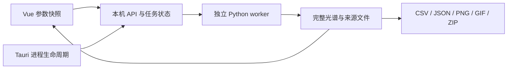

# SimLIBS 功能与计算原理

日期：2026-10-14。本文对应 Vue 桌面真实后端及 `finite-lte-slab-1` 高级模型。实现、自测与独立验收是不同证据；本轮最终验收以 plan 的 review 为准。

## 目录

1. [架构与运行](#架构与运行)
2. [三种基础模式与单位](#三种基础模式与单位)
3. [本地布居与展宽](#本地布居与展宽)
4. [页面功能与任务](#页面功能与任务)
5. [高级模拟推导](#高级模拟推导)
6. [导出与可复现示例](#导出与可复现示例)
7. [验证证据与适用边界](#验证证据与适用边界)

## 架构与运行

正式入口为 `dist-desktop/SimLIBS.exe`，便携分发必须携带同目录 `backend/`；安装包为 `dist-desktop/SimLIBS-Setup.exe`。Tauri 2 原生窗口加载 Vue 静态资源，Rust 启动本应用拥有的 Python 服务，Vue 用受 token 保护的本机 HTTP API 提交任务。Python worker 执行真实计算，保存任务状态、CSV、来源及诊断；界面不生成替代科学数据。失败和取消保留上一成功结果。

Python 未嵌入安装包。本机使用 Python 3.11，依赖包括 NumPy、pandas、SciPy、Matplotlib、Pillow、requests、Selenium 及源引擎所需依赖；具体环境检测以设置页和启动日志为准。在线模式还需要网络、Chrome 和版本匹配的驱动。解释器可通过 `SIMLIBS_UI_PYTHON` 或设置指定。Windows 需要 WebView2；安装程序可能联网安装运行时，当前未签名，未执行完整安装流程验证。

本轮科学检查的实际版本为 Python 3.11.16、NumPy 2.4.6、SciPy 1.17.1、pandas 3.0.5。高级模块使用 `numpy.trapezoid`，旧 NumPy 1.x 环境不能直接视为已兼容；部署应复用已验证环境或另行验证依赖版本。



桌面服务使用分配的回环端口及随机 token。资源从 Tauri resource_dir 解析，安装资源只读；配置、会话、日志、驱动缓存和默认输出写用户数据目录。应用仅终止自身拥有的进程树，不按 Python/Chrome 进程名清理。浏览器开发连接的外部服务不归应用终止。

开发在 Vue 根目录执行 `npm ci`、`npm run desktop:dev`；正式构建 `npm run desktop:build` 包含类型检查、静态构建、Rust release、中文 NSIS 和根目录收集。`npm run build` 本身不生成桌面程序。依赖锁文件保留。

## 三种基础模式与单位

| 模式 | 数据和计算位置 | 应理解为 |
| --- | --- | --- |
| local，本地库 | 有限本地线表、Python LTE/Saha 与可选展宽 | 有限数据与明确近似下的本地模型 |
| client，NIST谱线本地强度展宽 | NIST 页面 dataSticksArray 的线强，Python 展宽和采样 | 使用官方线强但展宽/网格与官方页面可能不同 |
| server，NIST服务器 | 官方页面计算及展宽，抓取官方结果 | 该次官方输出及其参数/采样约定 |

Te 单位 eV，是电子温度的能量表示；Ne 单位 cm⁻³，界面输入实际密度，例如 `1e17`。波长单位 nm。R 为无量纲分辨率，FWHM 约为 λ/R。Photon 与 Energy 不可直接混比；转换涉及光子能量 hc/λ。高级模型只输出光子谱。

本地关闭展宽时保留精确原始线位，R 不参与实际计算，图表标“未展宽（R 不应用）”；请求 R 仍保存在导出参数中。来源中的实际参数与当前编辑草稿分开。普通谱的任意强度单位不是探测器绝对计数。

NIST 官方页面的线形定义与 Python 常用 FWHM 定义并非自动相同。例如 exp[-(Δλ/w)²] 中 w 是 1/e 半宽，FWHM=2√ln(2)w；标准 Gaussian 的 FWHM=2√(2ln2)σ。比较前必须统一物理量、线宽定义、采样与归一化，不能仅对齐 R 标签。

## 本地布居与展宽

本地线库保存波长、Aki、上下能级及统计权重，有限能级配分函数为 U_z(T)=Σ_i g_i exp(-E_i/Te)，其中 E_i 换算为 eV。能级人口比例为 g_i exp(-E_i/Te)/U_z。Saha 相邻电离级比例为：

```
n_(z+1)/n_z = (2/ne) (2π me kT/h²)^(3/2) (U_(z+1)/U_z) exp(-χ_z/kT)
```

公式采用 SI 的 ne，需要把 cm⁻³ 乘 10⁶；Te[eV] 与 kT 的转换必须一致。源实现使用有限数据集，并非所有真实高激发态/电离级的完整配分函数。高级模型只采用有数据的 I/II，不虚构 III 能级。设置的最大发射电荷控制输出发射，不代表消除了其他人口。

光学薄光子线强正比于上能级人口乘 Aki；能量谱还乘光子能量。普通本地绝对尺度有其模型约定，与高级指定柱密度辐亮度不能直接混用。

Gaussian 标准差 σ=FWHM/(2√(2ln2))；Lorentz 半宽 γ=FWHM/2；Voigt 是二者卷积。热 Doppler Gaussian FWHM=λ√(8kT ln2/(mc²))，这里重粒子温度可与电子温度独立。Gaussian 宽度以平方和合并，Lorentz 宽度按适用约定组合。用户输入的 Lorentz 宽度不是由完整碰撞/Stark 数据库预测所得。

原始节点、未展宽投影和连续插值有不同含义。原始线位保持离散谱；未展宽投影将线权重守恒映射到统一轴，不宣称新物理线宽；连续谱线性插值在已有节点间取值，不补充未观测原子数据。导出来源记录实际节点与处理方式，不能把提高采样密度称为提高仪器分辨率。

## 页面功能与任务

单次模拟验证组成合计100%、波段、Te/Ne/R与模式限制，再捕获提交快照。图谱摘要对应该成功快照，不随后续草稿改变。图表支持总谱/元素、共同归一化、悬停原节点、框选/滚轮缩放、中键或 Alt 拖动平移、右键全谱及键盘操作。主题、五配色、减少动态仅改变显示。

批量模拟支持固定、随机和 CSV 模板。随机在 Python 生成确定计划并记录种子和实际参数；Te 与实际 Ne 的随机范围为线性，不在前端二次随机。浓度开关与参数随机独立，固定值也必须有效。CSV 可覆盖相应草稿，参数用 `Te[eV]`、`Ne[cm^-3]`、`R` 等明确列名；裸 Ne/Te 可能是元素。模板验证与任务使用同一实际内容，清除后恢复草稿规则。

批量最多5000样本，总谱单元5000000，CSV最多2 MB。列表分页，读取样本时显示已加载身份与目标加载状态；失败保留可辨认的旧谱并显示重试，过期请求不能改新选择。最多缓存3个完整样本。参数 CSV 与训练 CSV/ZIP来自成功任务快照，训练输出按包大小组织。取消后只有合法且未完成的 checkpoint 允许续跑；复用固定计划而非重新抽随机数。持久化和训练目录发布保留原子替换，Windows短暂占用有界重试，持续拒绝仍报错，不修改ACL。

随机浓度采用打乱元素顺序后的可行区间逐项分配：当前元素的上下界同时受到剩余元素上下界与总和100%的约束，最后一项接收剩余份额。计算边界使用 Decimal，保存最终实际浮点参数。这不是组成单纯形上的联合均匀抽样，也不代表真实材料分布；训练集设计时需自行检查覆盖和偏倚。Te/Ne 则在指定实际数值范围内做标量均匀抽样。

训练 ZIP 中 `Random_spectra.csv` 每个样本占两行，依次为波长、强度，无表头；对应的 `Random_contents.csv` 有元素表头，每个样本一行原子百分比标签。后续分包使用 `_2`、`_3` 等后缀，最后一包允许不足设定数量。标签采用固定参考元素顺序，额外元素按名称排序追加；未出现元素为0。所有样本必须共用完全相同的递增波长轴且值有限，否则拒绝打包。实际参数、可复用模板、来源和文件校验信息随包保存；未完成批量不能冒充完整训练包。普通“训练 CSV”数据集与此双行格式不是同一种文件，读取时应按对应格式处理。

扫描支持 Te、实际 Ne、整数 R，2–200帧，包含两端。Ne API 接收指数边界但实际扫描密度线性；显示以后端 manifest 值为准。R取整可能产生重复帧。R改变线宽需开启展宽。当前帧按需加载，最多缓存3帧，相同在途请求去重；新目标取消旧读取并忽略旧成功/失败。播放等待读取完成再安排下一帧；暂停、离页使在途播放失效。首帧在途离页后重入可恢复；播放失败重试实际失败目标。后台计算任务不会因切页自动取消。

任务记录持久化真实状态，区分计算失败与计算完成后读取失败。短暂通信失败进行3次有界自动恢复，耗尽后可明确重试；同一任务在途轮询去重。工作台和 Jobs 都显示结果读取错误及重试入口。取消由真实 worker 协作响应；旧成功结果不被取消任务覆盖。高级结果按独立任务类型重开。

设置保存连接、Python、输出目录与显示偏好。保存失败需恢复实际连接/后台输出及已保存偏好，避免只回滚界面。切换 Python 受控重启自身服务，活动任务期间拒绝重启。新输出目录用于新任务；历史任务仍引用原文件。原生打开/保存对话框仅授权用户选中的文件，取消不写文件；旧对话框全量点击验收仍暂停。

界面启动动画表示偏好、字体和首次布局准备，不代表已经计算光谱。日间、夜间、跟随系统及五种配色与减少动态设置独立于数据；原生标题栏同步主题。参数面板保持自然长高与整页滚动，成功完成后可自动收起，也可手动展开；不会因面板收起而丢失草稿或结果。科学数据始终保留完整节点，画布尺寸不决定数据点数。

## 高级模拟推导

模型是均匀、等温、无外来背景的有限能级 LTE slab。真实本地 Aki、上下能级和 g 决定发射与吸收，不是对普通谱任意削峰。用户输入总原子/离子柱密度 N[cm⁻²]，它不是 Ne；两者为独立指定条件，没有求解电荷中性或羽流动力学。

### 参数化基体

令名义元素分数 x_e 合计1，用户响应 r_e≥0。基体开启时：

```
Y = Σ x_e r_e
q_e = x_e r_e / Y
Te_eff = Te × f_Te ; Ne_eff = Ne × f_Ne
N_eff = N × Y
```

Y须正，响应默认1，倍率有限且为正；不是通过归一化 q 抹掉总产额。所有响应乘2会使薄谱产额乘2，同时改变自吸收柱密度。关闭基体提交恒等响应与倍率，保留界面草稿便于再开启；禁用草稿的非法文本不阻塞运行。开启后仍严格校验。此模型表达可校准元素响应和等离子体条件，不提供无需实验标定的普适材料预测。

后续实验校准建议：先用有证书组成的标准样品，固定激光能量、延迟、门宽和收光几何，并完成波长与仪器响应校准；利用尽量光学薄的谱线约束相对元素响应，用独立诊断或合适线比约束 Te/Ne，再利用同元素不同光学厚度的线约束柱密度。使用另一组样品验证，记录参数、实验条件、适用组成范围与误差。共同响应倍率和 N 在 `N_eff=N×Y` 中有退化关系，不能只凭一条归一化谱同时唯一反演；必须固定参考尺度或引入独立信息。当前程序提供参数输入与追溯导出，尚未实现实验拟合器、校准数据集管理或自动材料识别。

### 从能级到光学厚度

各级人口以有效组成、有限配分函数及 Saha 求得；柱密度乘10⁴把 cm⁻²转为 m⁻²。N_l、N_u 单位 m⁻²。内部频率 ν₀=(E_u-E_l)/h 来自能级差；λ₀=c/ν₀。原始波长空气/真空归属未明确，保留表中 nm 作为线位置，只在每条窄线的 Jacobian 处用能级差定义 λ₀，不强行把原始位置改成真空。

归一化 φ_ν 的单位 Hz⁻¹，Einstein 关系给出：

```
τ_ν = A_ul c²/(8πν₀²) [(g_u/g_l)N_l - N_u] φ_ν
```

采用 φ_λ[nm⁻¹] 时，φ_ν=φ_λ λ₀²/(c×10⁻⁹)。因此：

```
Cτ = A_ul λ₀⁴/(8π c ×10⁻⁹) × ΔN       [nm]
τ_λ = Cτ φ_λ                            [无量纲]
ΔN = (g_u/g_l) N_l × [-expm1(-(E_u-E_l)/Te_eff)]
```

最后一式使用稳定的 LTE 受激辐射差；能隙与 Te 同用 eV，不从可能为空气波长的线位推导另一个能隙。光学薄光子谱为 J_λ=N_u A_ul φ_λ/(4π)，单位 photons·s⁻¹·m⁻²·sr⁻¹·nm⁻¹。

### 先传输，再仪器卷积

在共同内禀轴上累加所有线的 τ 和各离子薄谱。采用沿该柱方向均匀 slab 的因子 β(τ)=[1-exp(-τ)]/τ，稳定计算 `-expm1(-τ)/τ`，τ=0时β=1。所有元素共享总τ及β：J_corrected,e=J_thin,e β(Στ)，故分量仍可相加。这里不是角平均逃逸概率或反馈修正布居模型。

内禀 Voigt 包含热 Doppler、指定 Gaussian 和 Lorentz；即使关闭自吸收也用于薄谱，仍须有效。随后才对三个谱施加同一个归一化仪器 Gaussian。仪器 FWHM=窗口中点/R；R不改变内禀光学厚度系数。数值网格会随 R/padding 变化，因此不同 R 的离散 τ 数组不能无条件逐节点相等，应对比系数或统一轴。

三条对照分别是：名义薄谱（原组成、原Te/Ne、原N、无基体）、基体薄谱（有效条件、N_eff、无吸收）、修正谱（有效条件、共享总τ传输后）。它们均经过同一仪器卷积且共用显示最大值，不能各自归一化，否则统一响应倍率和衰减会被隐藏。关闭自吸收时修正谱等于基体薄谱；关闭基体时两条薄谱相等；N=0时三谱为0。

### 网格与近似边界

相对波段跨度不超过中点5%，以限定中点仪器近似。内禀步长取最窄近似Voigt FWHM/8、输出步长/2和仪器σ/3的最小值，再除 refinement（1–4）。两端加8仪器σ padding，FFT卷积后输出到统一轴。内部最多200000点，通道数组单元最多5000000，谱线×点最多30000000；超过限制明确拒绝，引导缩小范围/减少元素/增大物理线宽，不偷偷降低分辨率。

有限窗口/线库和 Voigt 长尾仍是截断近似；padding不能代替完整远翼物理。模型不含时空梯度、背景照射、散射、连续吸收、完整Stark碰撞数据库、非LTE或布居反馈。可以给出饱和与展平，不声称预测温度梯度造成的自反转。模型光子辐亮度未校准为真实仪器读数。

## 导出与可复现示例

普通 CSV 导出实际波长、总谱及元素贡献；JSON保存来源和参数；前端 PNG为当前视口。高级 CSV 包含修正、基体薄、名义薄三曲线；后端 JSON自包含 comparison、逐线 line_diagnostics、全内禀 opacity/tau/beta及网格参数，不仅是本机文件路径。后端 PNG三谱共同绝对尺度并带图例和单位；前端 Canvas PNG包含绘入画布的三谱图例，共同归一化时注明尺度。批量参数/训练ZIP、扫描GIF按任务实际文件导出。

可复现高级示例：Fe100%，248–249nm，Te=1eV、Ne=1e17cm⁻³、R=1000，输出步长0.005nm，最大发射电荷1；N=1e16cm⁻²，内禀Gaussian FWHM=0.01nm、Lorentz FWHM=0.002nm、重粒子T=10000K，响应与倍率均1。运行得到201个输出节点。关闭自吸收比较修正谱与基体薄谱；令Fe响应2比较薄谱与名义薄谱；不要将这些绝对单位数值与普通任意强度直接混合。

可复现普通对照：server Fe100%、240–260nm、Te1、Ne1e17、R1000、charge1，保持Photon及官方节点，与同次参数的独立官方CSV比较。在线失败应保留错误并有限重试，不能伪造 Google Charts 对象或替换官方计算。

## 验证证据与适用边界

上一阶段 [科学验收](.ai-workflow/20261014-backend-connect/plan-native-science-results.json) 记录正式server该示例386节点与独立NIST CSV完全相等；client在统一NIST线宽约定下的归一化RMSE为0.0022976。此结果限定到该工况和比较规则，不证明任意工况等价。本地有限模型的差异需单独解释，未通过调整本地物理去拟合官方谱。server插值曾因外部图表 `google is not defined` 失败，定向重试成功，仍依赖外网页面。

具体比较采用上面的 Fe 240–260 nm 工况。server 原始386点与独立官方 CSV逐点完全相等；其余候选谱为1001点，将其线性取值到重叠的335个官方节点，两谱分别按自身峰值归一化，没有拟合位移或振幅。以下误差是该工况的谱形差异，不能解释为仪器测量不确定度：

| 候选模式 | 峰值归一化 RMSE | 最大归一化差 | 最强峰位置 / nm |
| --- | ---: | ---: | ---: |
| 官方 NIST 参考 | — | — | 240.59 |
| client，NIST 展宽约定 | 0.002297606（约0.23%） | 0.010104645 | 240.60 |
| client，FWHM 展宽约定 | 0.080453629（约8.05%） | 0.369394243 | 240.58 |
| local，本地展宽 | 0.223425719（约22.34%） | 0.857579518 | 259.92 |

本地最强峰改变不代表所有谱线统一偏移了19.33 nm；有限线库、有限配分函数、线强与展宽约定不同，主导谱线也会不同。不能把本地模型或高级自吸收模型称为 NIST 等价结果。


[本地模型对照图](.ai-workflow/20261014-backend-connect/plan-native-science-1791911894821949000/local-broadened.png)和[FWHM约定对照图](.ai-workflow/20261014-backend-connect/plan-native-science-1791911894821949000/client-fwhm-convention.png)保留了模型差异。官方离子列与总谱独立舍入，验收按 CSV 的有效位数核对允许舍入界限，不篡改官方值以强制浮点求和相等。

本轮 [独立物理检查](.ai-workflow/20261014-advanced-batch-scan/plan-physics-results.json) 包含解析双能级/Saha/Planck光子源与单位、独立quad积分、传输后卷积、网格细化、R不改系数、Fe/Cu混合总τ、开关/薄极限/非法输入/取消。[独立API检查](.ai-workflow/20261014-advanced-batch-scan/plan-api-results.json) 覆盖真实任务、重启历史、取消及三谱可携带导出；[code浏览器检查](.ai-workflow/20261014-advanced-batch-scan/code-browser-results.json) 覆盖真实页面和受控传输失败的恢复流程。最终正式桌面与冻结hash以本轮 implementation/files/code-ready 和 plan review 为准。

2026-10-14 最终验收通过，见 [plan review](.ai-workflow/20261014-advanced-batch-scan/review.md)。独立正式 EXE 的 [12项桌面检查](.ai-workflow/20261014-advanced-batch-scan/plan-native-results.json) 已通过，包含三谱所有绘制节点与 API 数值及共享尺度核对、实际响应2倍和吸收开关、批量旧响应隔离与失败重试、扫描暂停/快切/离页/首帧重入/失败目标重试、历史重开及正常退出清理。测试通过 WebView/CDP 操作实际正式程序，不冒称物理鼠标或原生文件对话框点击。

独立物理9项、API6项、原有本地三组逐节点回归均通过；code 另有普通后端78项、浏览器21项、轮询恢复3项、物理5项和原生7项自测。交付核对包含96个文件、94个后端资源和62份线表，原项目156项保护检查通过。最终 EXE SHA256 为 `faf22d97fca95eddfb190301fe4635678e6795faac10a69e147cd7f19a0bdcf3`；NSIS 为 `80bcddb95c966ab77d4cbe6f0c49df442e620bd00d26ea2ff332484f5018cae9`。安装过程及原生文件对话框全量测试仍未覆盖。

实现入口：[本地布居](backend/simlibs_ui/offline_engine.py)、[线库解析](backend/simlibs_ui/offline_database.py)、[高级模型](backend/simlibs_ui/advanced.py)、[API结果与导出](backend/web/real_backend.py)、[前端任务状态](src/lib/workbench.ts)。原子来源以每次 origin.atomic_sources、library签名和coverage为准；通用参考为 [NIST ASD](https://physics.nist.gov/asd) 与 [NIST LIBS](https://physics.nist.gov/PhysRefData/ASD/LIBS/libs-form.html)。数据可追溯不等于全部原子数据完整，也不等于实验校准。

物理背景可参考 Tatum 的 [Boltzmann/Saha 与恒星大气讲义](https://www.astro.uvic.ca/~tatum/stellatm/atm8.pdf)及[谱线轮廓讲义](https://www.astro.uvic.ca/~tatum/stellatm/atm10.pdf)。这些资料说明基础关系；本项目的有限数据、窄带仪器和参数化基体近似仍以本文件及实际代码为准。
