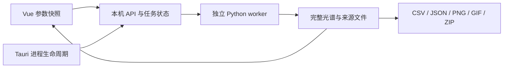

# SimLIBS 功能与计算原理

日期：2026-10-25。高级页新请求仅提供“客户端模拟”，在线取得 NIST 谱线，使用原 nist 协议在本地计算 Stark、逐线自吸收与仪器响应；默认波段和物理联动保持。新入口不再提供论文选择、柱密度参数或论文专属校验。历史 paper-eq7-stark-sa-1 与 finite-lte-slab-1 结果仍按原版本/来源解释、查看和导出，后端实现及数据不删除。当前入口实现与自测见 [.ai-workflow/20261025-advanced-client-mode/implementation.md](.ai-workflow/20261025-advanced-client-mode/implementation.md)，最终审查由独立 review 完成。下文带日期的实现/验收段落及离线论文推导保留为历史，不代表当前可选入口。

## 客户端模拟（原NIST高级入口，2026-10-16引入）

默认Mg100%、真空285.27–285.33nm、Te=1eV、Ne=1e17cm⁻³、R=1000、步长0.001nm。高级专用适配层取得同次响应的计算光子线强、跃迁gA和全部阶段能级，复用原始 prepare_nist_absorption / render_nist_absorption，不执行网页JS。仅按原字节增加nist_lines.py/nist_self_absorption.py，旧simulation.py/self_absorption.py不变，普通local/client/server语义不变。

NIST线强作为积分面积；布居使用全阶段及裸核态，发射电荷仍限定0–2。Stark W依次来自用户CSV、内置逐线系数及STARK-B自动补充，FWHM_Stark=2W·Ne/Ne_ref。仪器w=λ/R是高斯1/e半宽，FWHM_G=2√ln2·λ/R；R不进入τ。默认Ne/平均电荷反推总密度，可指定数密度；L=0及关闭自吸收均得到同Stark/Voigt薄谱。新入口不保留5%限制，但执行200000节点和源引擎工作量/内存上限。输出是NIST相对光子强度，不标成绝对光子辐亮度。

名义与有效Te/Ne/组成分别请求NIST，完全相同的规范化请求在单任务内复用。可选未标定基体先改变有效组成/条件，再把产额倍率作用于有效NIST线强及吸收粒子密度；逐线诊断保留未缩放线强。不提供普适材料预测。三谱同网格同尺度，origin记录URL/响应hash/引擎版本/约定/配置/用户系数出处。

Stark CSV最大2MB、最多20000行，支持BOM。必需element、非负整数charge、正W，以及真空波长或成对能级；参考Ne须为正。所有给定标识共同匹配，沿用原引擎1e-6 nm/eV阈值。完整缺失CSV按双精度保存，填W后可重导入；高级 Vue 入口省略 missing_stark 时默认 unbroadened：系数未知的跃迁保留 NIST 线面积，有仪器则仅应用仪器响应，无仪器则保面积/质心投影；跳过这些线的 Stark 和自吸收，未计算的物理量在 JSON 中为 null，SA=1 仅表示未施加衰减。显式 error 保留严格拒绝与 CSV 补数重跑。网络/TLS/服务解析/歧义/缓存错误仍报错。固定 job export 的 stark-missing/stark-matched 可导出成功或失败的高级任务清单；diagnostics导出成功结果的完整诊断CSV。轮询只有数量/可用标志，不塞逐线数组，刷新/重启可恢复固定任务证据。origin.stark_coverage 记录 partial/unavailable/complete/not-applied 及名义/有效条件覆盖；缺失计数按跃迁合并，matched_condition_count 按条件-跃迁计数，不把缺失线计为已匹配。前端将成功覆盖提示及缺失/匹配下载绑定显示结果原 job，严格失败清单绑定失败 job，三谱CSV/JSON/PNG与诊断不串绑；更早缺字段记录防御读取。

HTTP继承TLS、连接/读取及分段期限，增加响应大小边界，进度按取数/准备/渲染/保存真实阶段报告。原始渲染函数无逐行取消回调；网络读取和阶段边界协作检查，耗时计算由现有worker进程树取消兜底。不改物理公式，不终止用户其它进程。

46项后端与8项SSR/组件/脚本检查通过；其中数学和HTTP闭环用捕获NIST夹具，不冒充在线实算。另一次真实NIST窄带成功：1条跃迁、61个节点，URL/hash见 [.ai-workflow/20261016-advanced-nist/](.ai-workflow/20261016-advanced-nist/)。GUI未测，不重试受拒浏览器启动；本轮只交源码及前端dist。以上检查数量与未打包说明仅对应2026-10-16历史交付；下方高级推导保留为离线论文模型及历史证据。

## 独立展宽机制与元素视图（2026-10-17）

高级模拟支持三个独立布尔开关：self_absorption、stark_broadening、instrument_broadening，对应 6 种有效物理分支：
1. 纯棒状投影（SA=False, Stark=False, Instrument=False）：调用 nist_lines.render_sticks(instrument_broadening=False)，在共享网格上做精确线位与面积离散投影，不伪造物理线宽，高度依赖步长；跳过原子能级与 Stark 数据。
2. 纯仪器高斯（SA=False, Stark=False, Instrument=True）：调用 nist_lines.render_sticks(instrument_broadening=True)，以 w=λ/R (1/e 半宽) 进行仪器高斯卷积；跳过原子能级与 Stark 数据。
3. 纯 Stark Lorentz（SA=False, Stark=True, Instrument=False）：调用 prepare_nist_absorption(self_absorption=False) 与 render_nist_absorption(self_absorption=False)，直接解析跃迁与 Stark 宽度，生成解析 Lorentz 轮廓，跳过全能级布居与 Saha 计算；光程与吸收密度不影响结果。
4. Stark + 仪器 Voigt 薄谱（SA=False, Stark=True, Instrument=True）：同上并在内禀 Stark 基础上叠加仪器高斯响应，生成解析 Voigt 轮廓，无自吸收衰减。
5. 逐线自吸收 + 内禀 Stark（SA=True, Stark=True, Instrument=False）：计算全阶段布居、吸收密度、tau 与 SA，输出经自吸收修正但未经仪器卷积的光谱。
6. 逐线自吸收 + Stark + 仪器响应（SA=True, Stark=True, Instrument=True）：完整物理自吸收与仪器响应 Voigt 光谱。

约束：开启自吸收必须启用 Stark 展宽（前端约束联动，后端严格校验拒绝）。
界面布局与展示：
- AdvancedPage 实验参数顶部采用 Te / eV、Ne / cm⁻³、R (λ/Δλ) 三张横排方卡，与单次模拟一致。
- AdvancedResults 增加“元素组分”与“三谱对照”分段切换，默认元素组分；元素组分视图共享总谱尺度，可独立切换各元素可见性，导出 PNG/CSV 与当前视图严格一致。

## 目录

1. [架构与运行](#架构与运行)
2. [三种基础模式与单位](#三种基础模式与单位)
3. [本地布居与展宽](#本地布居与展宽)
4. [页面功能与任务](#页面功能与任务)
5. [高级模拟推导（历史离线论文模型）](#高级模拟推导历史离线论文模型)
6. [导出与可复现示例](#导出与可复现示例)
7. [验证证据与适用边界](#验证证据与适用边界)

## 架构与运行

正式入口为 `dist-desktop/SimLIBS.exe`，便携分发必须携带同目录 `backend/`；安装包为 `dist-desktop/SimLIBS-Setup.exe`。Tauri 2 原生窗口加载 Vue 静态资源，Rust 启动本应用拥有的 Python 服务，Vue 用受 token 保护的本机 HTTP API 提交任务。Python worker 执行真实计算，保存任务状态、CSV、来源及诊断；界面不生成替代科学数据。失败和取消保留上一成功结果。

Python 未嵌入安装包。本机使用 Python 3.11，依赖包括 NumPy、pandas、SciPy、Matplotlib、Pillow、requests、Selenium 及源引擎所需依赖；具体环境检测以设置页和启动日志为准。在线模式还需要网络、Chrome 和版本匹配的驱动。解释器可通过 `SIMLIBS_UI_PYTHON` 或设置指定。Windows 需要 WebView2；安装程序可能联网安装运行时，当前未签名，未执行完整安装流程验证。

本轮科学检查的实际版本为 Python 3.11.16、NumPy 2.4.6、SciPy 1.17.1、pandas 3.0.5。高级模块使用 `numpy.trapezoid`，旧 NumPy 1.x 环境不能直接视为已兼容；部署应复用已验证环境或另行验证依赖版本。



桌面服务使用分配的回环端口及随机 token。资源从 Tauri resource_dir 解析，安装资源只读；配置、会话、日志、驱动缓存和默认输出写用户数据目录。应用仅终止自身拥有的进程树，不按 Python/Chrome 进程名清理。浏览器开发连接的外部服务不归应用终止。

开发在 Vue 根目录执行 `npm ci`、`npm run desktop:dev`；正式构建 `npm run desktop:build` 包含类型检查、静态构建、Rust release、中文 NSIS 和根目录收集。`npm run build` 本身不生成桌面程序。依赖锁文件保留。

## 三种基础模式与单位

| 模式 | 数据和计算位置 | 应理解为 |
| --- | --- | --- |
| local，本地库 | 有限本地线表、Python LTE/Saha 与可选展宽 | 有限数据与明确近似下的本地模型 |
| client，NIST谱线本地强度展宽 | NIST 页面 dataSticksArray 的线强，Python 展宽和采样 | 使用官方线强但展宽/网格与官方页面可能不同 |
| server，NIST服务器 | 官方页面计算及展宽，抓取官方结果 | 该次官方输出及其参数/采样约定 |

Te 单位 eV，是电子温度的能量表示；Ne 单位 cm⁻³，界面输入实际密度，例如 `1e17`。波长单位 nm。R 为无量纲分辨率，FWHM 约为 λ/R。Photon 与 Energy 不可直接混比；转换涉及光子能量 hc/λ。高级模型只输出光子谱。

本地关闭展宽时保留精确原始线位，R 不参与实际计算，图表标“未展宽（R 不应用）”；请求 R 仍保存在导出参数中。来源中的实际参数与当前编辑草稿分开。普通谱的任意强度单位不是探测器绝对计数。

NIST 官方页面的线形定义与 Python 常用 FWHM 定义并非自动相同。例如 exp[-(Δλ/w)²] 中 w 是 1/e 半宽，FWHM=2√ln(2)w；标准 Gaussian 的 FWHM=2√(2ln2)σ。比较前必须统一物理量、线宽定义、采样与归一化，不能仅对齐 R 标签。

## 本地布居与展宽

本地线库保存波长、Aki、上下能级及统计权重，有限能级配分函数为 U_z(T)=Σ_i g_i exp(-E_i/Te)，其中 E_i 换算为 eV。能级人口比例为 g_i exp(-E_i/Te)/U_z。Saha 相邻电离级比例为：

```
n_(z+1)/n_z = (2/ne) (2π me kT/h²)^(3/2) (U_(z+1)/U_z) exp(-χ_z/kT)
```

公式采用 SI 的 ne，需要把 cm⁻³ 乘 10⁶；Te[eV] 与 kT 的转换必须一致。源实现使用有限数据集，并非所有真实高激发态/电离级的完整配分函数。NIST高级入口使用响应中的全部阶段，历史离线论文模型使用其I/II/III快照。设置的最大发射电荷控制输出发射，不代表消除了其他人口。

光学薄光子线强正比于上能级人口乘 Aki；能量谱还乘光子能量。普通本地绝对尺度有其模型约定，与高级指定柱密度辐亮度不能直接混用。

Gaussian 标准差 σ=FWHM/(2√(2ln2))；Lorentz 半宽 γ=FWHM/2；Voigt 是二者卷积。热 Doppler Gaussian FWHM=λ√(8kT ln2/(mc²))，这里重粒子温度可与电子温度独立。Gaussian 宽度以平方和合并，Lorentz 宽度按适用约定组合。用户输入的 Lorentz 宽度不是由完整碰撞/Stark 数据库预测所得。

原始节点、未展宽投影和连续插值有不同含义。原始线位保持离散谱；未展宽投影将线权重守恒映射到统一轴，不宣称新物理线宽；连续谱线性插值在已有节点间取值，不补充未观测原子数据。导出来源记录实际节点与处理方式，不能把提高采样密度称为提高仪器分辨率。

## 页面功能与任务

单次模拟验证组成合计100%、波段、Te/Ne/R与模式限制，再捕获提交快照。图谱摘要对应该成功快照，不随后续草稿改变。图表支持总谱/元素、共同归一化、悬停原节点、框选/滚轮缩放、中键或 Alt 拖动平移、右键全谱及键盘操作。主题、五配色、减少动态仅改变显示。

批量模拟支持固定、随机和 CSV 模板。随机在 Python 生成确定计划并记录种子和实际参数；Te 与实际 Ne 的随机范围为线性，不在前端二次随机。浓度开关与参数随机独立，固定值也必须有效。CSV 可覆盖相应草稿，参数用 `Te[eV]`、`Ne[cm^-3]`、`R` 等明确列名；裸 Ne/Te 可能是元素。模板验证与任务使用同一实际内容，清除后恢复草稿规则。

批量最多5000样本，总谱单元5000000，CSV最多2 MB。列表分页，读取样本时显示已加载身份与目标加载状态；失败保留可辨认的旧谱并显示重试，过期请求不能改新选择。最多缓存3个完整样本。参数 CSV 与训练 CSV/ZIP来自成功任务快照，训练输出按包大小组织。取消后只有合法且未完成的 checkpoint 允许续跑；复用固定计划而非重新抽随机数。持久化和训练目录发布保留原子替换，Windows短暂占用有界重试，持续拒绝仍报错，不修改ACL。

随机浓度采用打乱元素顺序后的可行区间逐项分配：当前元素的上下界同时受到剩余元素上下界与总和100%的约束，最后一项接收剩余份额。计算边界使用 Decimal，保存最终实际浮点参数。这不是组成单纯形上的联合均匀抽样，也不代表真实材料分布；训练集设计时需自行检查覆盖和偏倚。Te/Ne 则在指定实际数值范围内做标量均匀抽样。

训练 ZIP 中 `Random_spectra.csv` 每个样本占两行，依次为波长、强度，无表头；对应的 `Random_contents.csv` 有元素表头，每个样本一行原子百分比标签。后续分包使用 `_2`、`_3` 等后缀，最后一包允许不足设定数量。标签采用固定参考元素顺序，额外元素按名称排序追加；未出现元素为0。所有样本必须共用完全相同的递增波长轴且值有限，否则拒绝打包。实际参数、可复用模板、来源和文件校验信息随包保存；未完成批量不能冒充完整训练包。普通“训练 CSV”数据集与此双行格式不是同一种文件，读取时应按对应格式处理。

扫描支持 Te、实际 Ne、整数 R，2–200帧，包含两端。Ne API 接收指数边界但实际扫描密度线性；显示以后端 manifest 值为准。R取整可能产生重复帧。R改变线宽需开启展宽。当前帧按需加载，最多缓存3帧，相同在途请求去重；新目标取消旧读取并忽略旧成功/失败。播放等待读取完成再安排下一帧；暂停、离页使在途播放失效。首帧在途离页后重入可恢复；播放失败重试实际失败目标。后台计算任务不会因切页自动取消。

任务记录持久化真实状态，区分计算失败与计算完成后读取失败。短暂通信失败进行3次有界自动恢复，耗尽后可明确重试；同一任务在途轮询去重。工作台和 Jobs 都显示结果读取错误及重试入口。取消由真实 worker 协作响应；旧成功结果不被取消任务覆盖。高级结果按独立任务类型重开。

设置保存连接、Python、输出目录与显示偏好。保存失败需恢复实际连接/后台输出及已保存偏好，避免只回滚界面。切换 Python 受控重启自身服务，活动任务期间拒绝重启。新输出目录用于新任务；历史任务仍引用原文件。原生打开/保存对话框仅授权用户选中的文件，取消不写文件；旧对话框全量点击验收仍暂停。

界面启动动画表示偏好、字体和首次布局准备，不代表已经计算光谱。日间、夜间、跟随系统及五种配色与减少动态设置独立于数据；原生标题栏同步主题。参数面板保持自然长高与整页滚动，成功完成后可自动收起，也可手动展开；不会因面板收起而丢失草稿或结果。科学数据始终保留完整节点，画布尺寸不决定数据点数。

## 高级模拟推导（历史离线论文模型）

本节至本节末仅说明历史离线论文版本，包含当时Vue柱密度输入、元素/波段限制和示例，不适用于当前客户端入口。

保留的离线高级后端直接调用与原 simLIBS 相同的 `simLIBS.self_absorption.simulate_paper_spectrum`，依照 RSC Advances 2023 论文 *A numerical procedure for understanding the self-absorption effects in laser induced breakdown spectroscopy* 的 Eq.7 计算逐线吸收参数，并用论文 SA/展宽关系重建谱线。完整推导、数据核对和适用限制见 [核心中文报告](../simLIBS-2.0.3/SELF_ABSORPTION_REPORT.md)。这里不是对已经展宽的总谱任意削峰，也没有混用旧有限 slab 的连续总 tau 算法。

### 真实数据与三态布居

默认快照位于 `backend/source/simLIBS/data/paper_atomic_data.json`，包含论文 Table 1 的 Mg、Ca、Zn 共31条线及 NIST I/II/III 九份能级表。第一、第二电离能来自带URL和响应哈希的 Royal Society of Chemistry 元数据，不标为NIST来源。未列出的 Stark 参数不从旧 UI 线库补造；默认数据中 Fe 等缺少必要输入的元素会在高级提交时明确拒绝。Table 1 发射线覆盖 I/II；电荷上限0–2只筛选实际存在的发射线，不伪造 III 谱线。三态 Saha 布居始终计算 I/II/III，III 人口可影响 I/II 的浓度。

每个元素的配分函数使用所提供的真实束缚能级；被标记为非束缚的记录不进入求和。Te 与能级能量同用 eV；Ne 用 cm⁻³。给定 Te、Ne 后，Saha 方程与人口归一化给出各态分数。有限数据、LTE、无更高态和无连续降低的近似都保存在结果元数据中。数据文件位置、SHA256、人口、配分函数和电荷平衡诊断可从 `origin.paper_model` 追溯。

### 柱密度、光程与参数化基体

Vue 输入总原子/离子柱密度 `N_col[cm⁻²]` 与光程 `L[m]`（默认0.01 m），换算：

```
N_total[cm⁻³] = N_col / (100 × L)
```

Ne 与 N_total 为独立指定条件。Vue 采用显式总数密度模式，不强迫二者满足电荷中性；共享引擎同时记录这些布居对应的电子密度及相对差异。原核心还支持缺省总密度时的电荷平衡闭合，Vue 当前参数表不使用该缺省分支。

令名义元素分数 x_e 合计1，用户响应 r_e≥0。基体开启时：

```
Y = Σ x_e r_e
x_eff,e = x_e r_e / Y
Te_eff = Te × f_Te ; Ne_eff = Ne × f_Ne
N_total,eff = N_total × Y
N_col,eff = N_col × Y
```

Y须正，默认响应与Te/Ne倍率均1。总产额倍率直接改变有效总数密度，没有被归一化组成消掉。各态数密度为 `N_s = N_total,eff × x_eff,e × f_s`，其中 f_s 为该元素Saha态分数。关闭基体时使用名义条件，禁用草稿保留以便再开启。此处表达可校准元素响应与等离子体修正，不提供无需实验标定的普适材料预测。共同响应倍率与柱密度有退化关系，不能只凭一条归一化谱唯一反演；实验校准仍需参考样品、独立诊断和独立验证样品。

### Eq.7、SA 与逐线峰高/积分

每条线使用论文 Aki、上下能级、统计权重和 Stark 参数。以 m 为波长/光程单位、s⁻¹为Aki单位，并将 N_s 从 cm⁻³乘10⁶转为m⁻³，Eq.7为：

```
q[m] = N_s[m⁻³] × g_u × λ₀[m]^4 × A_ul[s⁻¹] × L[m]
       / (4π² c[m/s] U_s) × exp(-E_l/Te_eff)
w₀[nm] = 2 × W_table[nm] × (Ne_eff / Ne_reference)
tau_center = q[m] / (w₀[nm] × 10⁻⁹)
SA = -expm1(-tau_center) / tau_center          # tau=0 时取1
w_abs = w₀ × SA^(-0.54)
```

表中的 W 是论文 Stark 宽度参数，未吸收 FWHM 为2W并按Ne线性缩放。没有自行添加论文未给出的温度依赖。tau只使用未吸收的Stark FWHM；仪器分辨率和吸收后的线宽不进入分母。

谱线使用积分归一化的 Lorentz 轮廓 φ，单位 nm⁻¹。论文薄谱表达式作为相对积分权重使用；photon 权重与 energy 权重相差该线的光子能量 `hc/λ₀`。Vue 使用 photon，与普通本地页面约定一致，不宣称标定辐亮度或探测器计数。

论文 SA 表示仪器卷积前的内禀线中心峰高之比。因为轮廓按积分归一化且 FWHM 变宽，积分权重必须同时更新：

```
A_abs / A_thin = SA^(1 - 0.54) = SA^0.46
peak_abs / peak_thin = (A_abs/A_thin) × (w₀/w_abs) = SA
```

因此，不能把积分权重直接乘SA后又按SA展宽，否则线中心峰高会多衰减一次。各条线分别用自己的tau、SA、吸收FWHM和积分权重重建后，才按离子/元素叠加；没有再对总谱乘共享总tau/beta，也没有声称求解重叠谱线间耦合辐射输运。

### 仪器响应、三谱与网格

仪器 Gaussian 可选，默认为启用，FWHM=λ_line/R。在逐线自吸收更新之后，按解析 Voigt 轮廓应用仪器响应，R不改变q、Stark FWHM、tau或SA。旧热Doppler、附加Gaussian/Lorentz和refinement草稿仅用于兼容，不参与论文模型；不能把这些输入当成Stark数据。

三条对照分别为名义薄谱（原组成、Te/Ne及总数密度）、基体薄谱（有效条件，无吸收）、修正谱（有效条件，逐线SA/展宽）。它们使用相同输出网格、仪器设置和显示尺度，不能分别归一化来隐藏产额或吸收变化。关闭自吸收时修正谱等于基体薄谱；关闭基体时两薄谱相等；柱密度0时三谱均0且tau=0、SA=1。

当前Vue仍将相对波段跨度限制为中心5%，默认示例为Mg 284.5–286 nm、步长0.005 nm。共享引擎以请求步长建立严格递增输出轴，最多200000节点；单谱通道数组最多5000000单元，谱线×节点工作量最多50000000。重复浮点节点、非法/非有限数据或超限输入会明确拒绝，不静默稀疏采样。Lorentz翼包含窗外线贡献，因此逐线诊断数可能大于窗口内线中心数；有限窗口积分不等于整条线的无限区间积分。

### 历史模型与科学边界

`finite-lte-slab-1` 是2026-10-14的旧高级模型，使用有限I/II能级、Voigt内禀谱、累加连续总tau后乘beta，再做FFT仪器卷积。它不等于当前论文逐线算法，其旧EXE、历史结果与验收记录不能作为新模型验证。历史结果仍按原版本重开，页面和PNG不将旧诊断冒称新逐线中心诊断。

当前模型不含时空梯度、外来背景、散射、连续吸收、非LTE、布居反馈或更高电离态，不预测温度梯度导致的自反转。Table 1有限谱线/固定Stark参数和有限束缚能级表不是通用完整碰撞数据库；本次实现也不是对作者未公开源码的逐字复现。原核心可接受具有真实必要字段的自定义线/原子数据；Vue默认页面当前只提供论文Mg/Ca/Zn快照。更完整的限制与数据可追溯说明以核心报告和每次实际origin为准。

## 导出与可复现示例

普通 CSV 导出实际波长、总谱及元素贡献；JSON保存来源和参数；前端 PNG为当前视口。高级 CSV 包含修正、基体薄、名义薄三曲线；后端 JSON自包含 comparison、逐线 line_diagnostics、逐线中心 opacity/tau/beta及网格参数，不仅是本机文件路径。当前opacity每行对应一条线中心，tau映射tau_center、beta映射SA，origin明确标记per-line-center，不是连续总光学厚度。可缺省的Stark参考温度等字段读回JSON null，不产生NaN。后端 PNG三谱共用模型强度尺度并带图例和单位；前端 Canvas PNG包含绘入画布的三谱图例，共同归一化时注明尺度。批量参数/训练ZIP、扫描GIF按任务实际文件导出。

历史离线论文示例（当前高级页不再提交此模型）：Mg100%，284.5–286nm，Te=1eV、Ne=1e17cm⁻³、R=1000，输出步长0.005nm，最大发射电荷2；柱密度1e16cm⁻²，L=0.01m，响应与倍率均1，仪器Gaussian启用。得到301个输出节点。关闭自吸收比较修正谱与基体薄谱；令Mg响应2比较薄谱与名义薄谱。默认Fe不具备本模型所需Stark数据，不能继续使用旧Fe高级示例。真实worker/API/三谱导出证据见 [Vue实施说明](.ai-workflow/20261015-paper-self-absorption/implementation.md)。

可复现普通对照：server Fe100%、240–260nm、Te1、Ne1e17、R1000、charge1，保持Photon及官方节点，与同次参数的独立官方CSV比较。在线失败应保留错误并有限重试，不能伪造 Google Charts 对象或替换官方计算。

## 验证证据与适用边界

2026-10-15历史论文版本的Vue高级测试与models/storage/web_api回归共38项通过，父plan复跑也通过；便携Node22.16环境下Vue类型检查和静态构建已通过。独立真实RealBackend worker完成301节点Mg模拟，三谱CSV/严格JSON/PNG导出已逐值核对并保存 [请求、进度与文件证据](.ai-workflow/20261015-paper-self-absorption/evidence/20261015-154332/summary.json)。共享原核心的科学验收和最新边界修复以 [核心报告](../simLIBS-2.0.3/SELF_ABSORPTION_REPORT.md) 为准。

2026-10-15当轮只交付源码、Python后端和Markdown报告，未重打包或更新dist-desktop旧EXE/NSIS。Tauri资源白名单及collect-desktop脚本已补论文JSON路径；收集规则通过隔离临时项目的真实Node脚本验证，生产发行目录未被该测试修改。实际安装包资源、原生文件对话框与新桌面程序的运行行为仍需在具备Rust/Cargo的环境重新构建后验证。

### 2026-10-14历史基础模式与旧高级验收

以下为此前工况和旧finite-slab版本的历史事实，不是本轮论文引擎或新EXE的验收结果。

上一阶段 [科学验收](.ai-workflow/20261014-backend-connect/plan-native-science-results.json) 记录正式server该示例386节点与独立NIST CSV完全相等；client在统一NIST线宽约定下的归一化RMSE为0.0022976。此结果限定到该工况和比较规则，不证明任意工况等价。本地有限模型的差异需单独解释，未通过调整本地物理去拟合官方谱。server插值曾因外部图表 `google is not defined` 失败，定向重试成功，仍依赖外网页面。

具体比较采用上面的 Fe 240–260 nm 工况。server 原始386点与独立官方 CSV逐点完全相等；其余候选谱为1001点，将其线性取值到重叠的335个官方节点，两谱分别按自身峰值归一化，没有拟合位移或振幅。以下误差是该工况的谱形差异，不能解释为仪器测量不确定度：

| 候选模式 | 峰值归一化 RMSE | 最大归一化差 | 最强峰位置 / nm |
| --- | ---: | ---: | ---: |
| 官方 NIST 参考 | — | — | 240.59 |
| client，NIST 展宽约定 | 0.002297606（约0.23%） | 0.010104645 | 240.60 |
| client，FWHM 展宽约定 | 0.080453629（约8.05%） | 0.369394243 | 240.58 |
| local，本地展宽 | 0.223425719（约22.34%） | 0.857579518 | 259.92 |

本地最强峰改变不代表所有谱线统一偏移了19.33 nm；有限线库、有限配分函数、线强与展宽约定不同，主导谱线也会不同。不能把本地模型或高级自吸收模型称为 NIST 等价结果。


[本地模型对照图](.ai-workflow/20261014-backend-connect/plan-native-science-1791911894821949000/local-broadened.png)和[FWHM约定对照图](.ai-workflow/20261014-backend-connect/plan-native-science-1791911894821949000/client-fwhm-convention.png)保留了模型差异。官方离子列与总谱独立舍入，验收按 CSV 的有效位数核对允许舍入界限，不篡改官方值以强制浮点求和相等。

2026-10-14旧高级模型的 [独立物理检查](.ai-workflow/20261014-advanced-batch-scan/plan-physics-results.json) 包含解析双能级/Saha/Planck光子源与单位、独立quad积分、传输后卷积、网格细化、R不改系数、Fe/Cu混合总τ、开关/薄极限/非法输入/取消。[独立API检查](.ai-workflow/20261014-advanced-batch-scan/plan-api-results.json) 覆盖真实任务、重启历史、取消及三谱可携带导出；[code浏览器检查](.ai-workflow/20261014-advanced-batch-scan/code-browser-results.json) 覆盖真实页面和受控传输失败的恢复流程。这组证据和下列EXE哈希仅对应2026-10-14历史交付，不用于声明本轮论文引擎已进入发行物。

2026-10-14 最终验收通过，见 [plan review](.ai-workflow/20261014-advanced-batch-scan/review.md)。独立正式 EXE 的 [12项桌面检查](.ai-workflow/20261014-advanced-batch-scan/plan-native-results.json) 已通过，包含三谱所有绘制节点与 API 数值及共享尺度核对、实际响应2倍和吸收开关、批量旧响应隔离与失败重试、扫描暂停/快切/离页/首帧重入/失败目标重试、历史重开及正常退出清理。测试通过 WebView/CDP 操作实际正式程序，不冒称物理鼠标或原生文件对话框点击。

独立物理9项、API6项、原有本地三组逐节点回归均通过；code 另有普通后端78项、浏览器21项、轮询恢复3项、物理5项和原生7项自测。交付核对包含96个文件、94个后端资源和62份线表，原项目156项保护检查通过。最终 EXE SHA256 为 `faf22d97fca95eddfb190301fe4635678e6795faac10a69e147cd7f19a0bdcf3`；NSIS 为 `80bcddb95c966ab77d4cbe6f0c49df442e620bd00d26ea2ff332484f5018cae9`。安装过程及原生文件对话框全量测试仍未覆盖。

实现入口：[本地布居](backend/simlibs_ui/offline_engine.py)、[线库解析](backend/simlibs_ui/offline_database.py)、[高级模型](backend/simlibs_ui/advanced.py)、[API结果与导出](backend/web/real_backend.py)、[前端任务状态](src/lib/workbench.ts)。普通本地原子来源以每次 origin.atomic_sources、library签名和coverage为准；当前高级来源以 origin.paper_model / nominal_paper_model 的数据SHA256、人口、配分函数和参数为准；通用参考为 [NIST ASD](https://physics.nist.gov/asd) 与 [NIST LIBS](https://physics.nist.gov/PhysRefData/ASD/LIBS/libs-form.html)。数据可追溯不等于全部原子数据完整，也不等于实验校准。

物理背景可参考 Tatum 的 [Boltzmann/Saha 与恒星大气讲义](https://www.astro.uvic.ca/~tatum/stellatm/atm8.pdf)及[谱线轮廓讲义](https://www.astro.uvic.ca/~tatum/stellatm/atm10.pdf)。这些资料说明基础关系；普通模式的有限数据与展宽以本文件及实际代码为准，当前论文逐线高级模型以 [核心报告](../simLIBS-2.0.3/SELF_ABSORPTION_REPORT.md)、本文件高级章节和实际代码为准。
