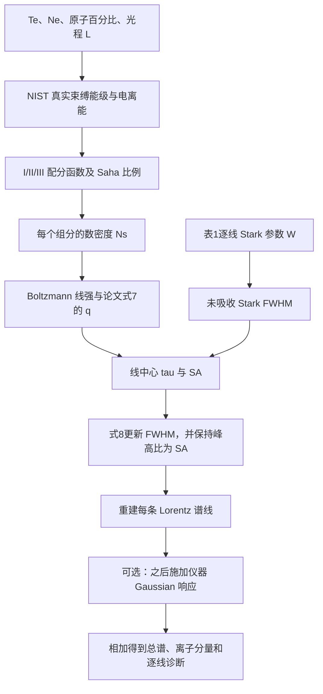
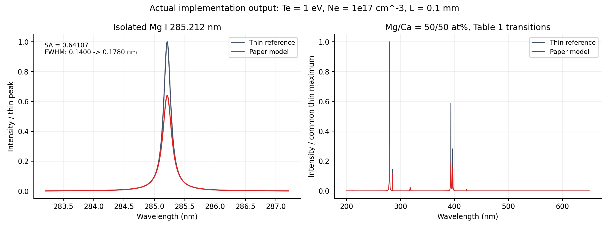
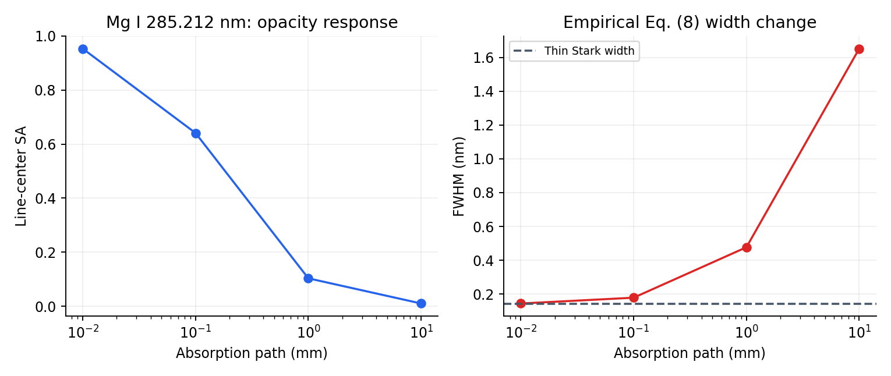

# SimLIBS 论文逐线自吸收模型：原理、实现与验证

> 历史存档，2026-10-28 更新：本文下方记录的是已移除的离线论文模型，旧 API、示例命令和本地数据文件均不再提供，不作为当前使用说明。当前 Python 版本的 Stark 系数统一来自 STARK-B 数据库或其已验证响应缓存，自吸收仍采用本文所述逐线经验关系。最新调用见 [README](README.md)，数据边界见 [Stark 数据覆盖记录](STARK_DATA_COVERAGE.md)。历史图、CSV 和结果元数据仅作旧结果记录。

日期：2026-10-15。适用代码：原始 `simLIBS-2.0.3` 核心与 Vue 高级模拟后端。

本文说明本次实际实现的算法、数据和验证结果。代码依据 John 与 Anoop 的论文方程建立逐线模型；论文未公开的配分函数清单、程序源代码、线形归一化与宽度迭代细节，不以猜测补成“作者原始实现”。

## 1. 依据与实现范围

主要文献：L. M. John and K. K. Anoop, **A numerical procedure for understanding the self-absorption effects in laser induced breakdown spectroscopy**, *RSC Advances*, 2023, 13, 29613–29624，DOI：[10.1039/D3RA06226K](https://doi.org/10.1039/D3RA06226K)。

- PDF 第 2–3 页：Saha/Boltzmann 布居、线强、Stark 展宽与 Lorentz 线形，式（1）–（5）。
- PDF 第 3 页：线中心 SA、光学厚度及原子参数表达式，式（6）、（7）。
- PDF 第 4 页：自吸收引起的 FWHM 改变，式（8）。
- PDF 第 5 页：表 1 原子跃迁和 Stark 参数。
- PDF 第 6 页：图 2 的 Mg I 285.212 nm 峰高降低、线宽增大示例。

本次将 `SimulatedLIBS(self_absorption=True)` 从“用户输入整谱光学厚度，再逐点乘系数”改为：



普通 `self_absorption=False` 路径继续使用原有 NIST 模拟。Vue 的普通 local/client/server 路径不因本次高级模型替换而改成论文模型。

## 2. 源码与数据位置

| 文件 | 职责 |
| --- | --- |
| [self_absorption.py](simLIBS/self_absorption.py) | 配分函数、三态 Saha、逐线 q/SA/Stark 宽度、线形重建与可选仪器响应 |
| [simulation.py](simLIBS/simulation.py) | `SimulatedLIBS` 的开关、参数快照、重新采样、批量调用及既有取谱/导出接口 |
| [paper_atomic_data.json](simLIBS/data/paper_atomic_data.json) | 论文表 1 与 NIST 能级快照、来源 URL、响应哈希和解析统计 |
| [Vue 高级后端](../Vue/backend/simlibs_ui/advanced.py) | 参数化基体条件、柱密度换算、共享引擎调用、三谱与任务输出 |
| [运行示例](examples/paper_self_absorption_demo.py) | 实际生成本文图、CSV、逐线诊断和 JSON 元数据 |

两个后端使用内容一致的 `self_absorption.py` 和数据快照。Vue 分发源码中的位置是 `Vue/backend/source/simLIBS/`；不要在两个副本中分别发展不同的物理公式。

### 2.1 已内置的谱线范围

表 1 共 **31 条发射跃迁**：Mg 13 条、Ca 14 条、Zn 4 条，发射线属于 I/II。正文提到的某些其他谱线，例如 Mg II 280.270 nm，并不在表 1 中；程序没有为它们补造 Stark 参数。

默认不支持 Fe 等缺少相应 Stark/原子数据的元素；这类请求会明确报错，而不是借用旧本地线库、给所有线赋一个随意宽度或回退成整谱衰减。其他元素可通过自定义 `line_data`、`atomic_data` 或 `data_path` 接入。

### 2.2 配分函数数据

已从 [NIST ASD Levels 官方接口](https://physics.nist.gov/PhysRefData/ASD/levels_form.html)取得 Mg、Ca、Zn 的 I、II、III 全部九个能级表。完整 CSV 与另一份完整 ASCII 输出的 NIST ID、能量、J 和 g 逐表核对，并核对页面宣告的总行数。

| 光谱 | 可解析 state | 进入配分函数的束缚 state |
| --- | ---: | ---: |
| Mg I / II / III | 305 / 107 / 111 | 221 / 78 / 105 |
| Ca I / II / III | 780 / 71 / 181 | 455 / 69 / 175 |
| Zn I / II / III | 373 / 92 / 315 | 208 / 70 / 315 |
| 合计 | 2335 | **1696** |

响应共 2417 个数据行；35 个 Limit 行和 47 个 J 缺失、复合或不能唯一解析的行没有当成普通能级使用。可解析但达到/超过首个电离阈值的 state 留在快照中供追溯，通过 `is_bound=false` 排除出配分函数。不同真实 state 即使能量和 g 相同，也不按这两个数盲目去重。

第一、第二电离能沿用已有、有 URL 与响应哈希的 Royal Society of Chemistry 周期表元数据，并标为非 NIST 来源。当前能级快照为 NIST ASD 5.12；论文引用 5.10，作者的完整能级清单未公开，因此配分函数不宣称与作者逐数相同。

Stark 参数 W 按表 1 转录。参考电子密度取论文式（4）的归一化约定 `1e16 cm^-3`；表 1 未另行说明参考温度，数据中该温度为 `null`。本实现没有构造未提供的 W(T) 插值。

## 3. 参数与单位

| 参数 | 单位/约定 |
| --- | --- |
| `Te` | eV，表示电子热能 kBT |
| `Ne` | 实际电子密度，cm^-3，例如 `1e17`，不是指数 17 |
| `percentages` | 原子/数目百分比，非质量百分比，合计 100% |
| `path_length_m` | 有效吸收光程，m |
| `total_number_density_cm3` | 可选的总原子/离子数密度，cm^-3 |
| `wavelength_step_nm` | 输出波长采样步长，nm，不是仪器分辨率或线宽 |
| `resolution` | 无量纲 R，只在可选仪器响应中使用 |
| 线表波长 / 能量 / Aki | nm / eV / s^-1 |
| `stark_width_nm` | 论文 W 参数，nm，不能误当成已经乘电子密度的最终 FWHM |

式（7）内部转换为 SI：`Ns_m3 = Ns_cm3 * 1e6`、`lambda_m = lambda_nm * 1e-9`。最终 q 的单位为 m；计算 tau 时线宽也必须转换为 m。

## 4. 三态布居和密度闭合

对电离级 z 的真实束缚能级求有限配分函数：

$$
U_z(T_e)=\sum_{i\in\mathrm{bound}}g_i\exp(-E_i/T_e).
$$

能级能量和 Te 均为 eV。Saha 相邻态比例使用 SI 形式：

$$
\frac{n_{z+1}}{n_z}
=\frac{2}{n_e}
\left(\frac{2\pi m_e e T_e}{h^2}\right)^{3/2}
\frac{U_{z+1}}{U_z}\exp(-\chi_z/T_e),
\qquad n_e=N_e\times10^6.
$$

由 I→II、II→III 两个比例得到三个归一化分数 `f0,f1,f2`。计算采用对数形式和 `logsumexp`，减少指数溢出/下溢。没有真实 III 能级或必要电离能时明确报错，不用常数代替。

数密度有两种清楚区分的模式：

1. **默认电荷闭合模式**：给定 Ne、温度和组成，先得到各元素平均电荷，再令

   $$N_{\mathrm{total}}=N_e/\sum_e x_e\sum_{z=0}^{2}z f_{e,z}.$$

   然后 `Ns(e,z)=Ntotal * x_e * f(e,z)`。这是假设电子来自这些三态组分时的闭合。

2. **指定总密度模式**：显式提供 `total_number_density_cm3`，用它分配 Ns；Ne 仍用于 Saha 和 Stark。两者是独立给定条件，元数据记录由离子分布预测的电子密度及相对电荷不平衡，程序不悄悄修改用户参数。

I/II/III 是人口分配的截断模型。最大发射电荷只筛选已有发射线；不会消除其他级的人口，也不会制造表中没有的 III 发射线。

## 5. 每条跃迁的线强、光学厚度和宽度

### 5.1 光学薄积分线权重

使用论文式（2）的 Boltzmann 形式。能量尺度的相对积分线权重记为 J：

$$
J_{j,0}=\frac{hc}{4\pi\lambda_j}A_{ul,j}
N_{s,j}\frac{g_{u,j}}{U_{s,j}}\exp(-E_{u,j}/T_e).
$$

Photon 尺度去掉 `hc/lambda_j` 因子。程序默认核心使用 energy；Vue 为兼容原来的相对光子谱使用 photon，并对三个对照谱保持同一尺度。

J 是相对发射权重，未包含完整收光体积、探测效率和绝对标定。L 是吸收路径参数，本实现不再把 L 额外乘到这个相对薄谱权重上，因此不将输出宣称为标定的探测器计数或绝对辐亮度。

### 5.2 未吸收 Stark 宽度

采用论文式（4）的电子碰撞项：

$$w_{j,0}=2W_j\frac{N_e}{N_{e,\mathrm{ref},j}}.$$

默认参考电子密度为 `1e16 cm^-3`，W 与 w 都用 nm。没有用 `lambda/R` 替换 Stark 宽度。

### 5.3 q 与线中心光学厚度

将论文式（7）的温度写成当前程序的 eV 约定：

$$
q_j=\frac{N_{s,j}g_{u,j}\lambda_j^4A_{ul,j}L}
{4\pi^2cU_{s,j}}\exp(-E_{l,j}/T_e),
$$

这里 Ns、波长和光程采用 SI。注意指数是**下能级**能量，而薄谱线强的指数使用**上能级**能量。

本实现明确选择：式（6）分母使用**未吸收的 Stark FWHM**，先计算一次 tau 与 SA，再用式（8）更新吸收宽度：

$$\tau_{0,j}=q_j/(w_{j,0}\times10^{-9}).$$

原文式（6）的线宽记号与式（8）的吸收前/后记号不完全清楚；以上为可复现的一次更新约定，没有假装知道作者是否采用过隐式迭代。

### 5.4 SA 与宽度更新

$$
\mathrm{SA}_j=\frac{1-e^{-\tau_{0,j}}}{\tau_{0,j}},
\quad \mathrm{SA}(0)=1,
\qquad
w_{j,\mathrm{abs}}=w_{j,0}\,\mathrm{SA}_j^{-0.54}.
$$

代码使用 `-expm1(-tau)/tau` 保持薄极限稳定。SA 接近 1 表示吸收弱，接近 0 表示吸收强。指数 -0.54 是论文采用的经验关系，不是完整辐射传输方程的普适定理。

### 5.5 峰高比与积分面积不能混为一谈

标准面积归一化 Lorentz 线形为：

$$\phi(\lambda;\gamma)=\frac{1}{\pi}\frac{\gamma}{(\lambda-\lambda_0)^2+\gamma^2},\quad\gamma=w/2.$$

若薄谱为 `J0 * phi`，峰高为 `H0=J0/(pi*gamma0)`。论文式（6）定义的是峰高比，所以必须满足：

$$H_{\mathrm{abs}}/H_0=\mathrm{SA}.$$

结合宽度关系，正确的面积参数更新为：

$$
\frac{J_{\mathrm{abs}}}{J_0}
=\mathrm{SA}\frac{w_{\mathrm{abs}}}{w_0}
=\mathrm{SA}^{1-0.54}
=\mathrm{SA}^{0.46}.
$$

如果错误地把面积直接乘 SA，再将宽度扩大，最终峰高比会变成 `SA^1.54`，不再满足式（6）。本次测试独立检查了峰高、FWHM 和面积三个关系。

原文式（5）的线形排版及“峰强/线强”用词存在归一化歧义。本实现明确给出上述标准线形和约定，因此可复算，但不宣称与作者未公开代码的每个常数完全相同。

## 6. 合谱、仪器响应和采样

每条跃迁先完成自己的 SA 与宽度更新，再按离子通道与总谱相加。程序没有把合成光谱再次乘以一个总 beta，也没有把各条线当成完整的相互耦合吸收传输问题求解。

`instrument_broadening=False` 为原核心默认设置，直接保留论文的内禀 Lorentz 模型。开启时，每条线额外使用 `FWHM_G=lambda_line/R` 的 Gaussian 仪器响应；代码用解析 Voigt 线形计算卷积，而不是将仪器宽度写入 q、tau 或 Stark 宽度。该处理是独立、可关闭的仪器扩展。

SA 和逐线 FWHM 诊断指仪器响应之前的量。开启仪器卷积后，屏幕上测得的峰高比不必恰好等于该条线的内禀 SA。

输出轴包含两端，最多 200000 节点；另有通道单元和线数×点数上限。无法表示严格递增的浮点网格、非有限派生量和畸形线表会明确拒绝。输出采样步长仍需足够小；解析求值不等于粗网格能分辨任意窄峰。

有限窗口外的已选谱线仍参与 Lorentz 翼部贡献。因此诊断中的线数可大于窗口内线中心数，最大 tau/最小 SA 也可能属于窗外谱线，不能一概理解为当前可见峰的值。

自吸收展宽会把线强重新分配到翼部，某些远翼节点可能高于薄谱；不能再强制每个节点都小于薄谱。无限积分意义上的单线面积按 `SA^0.46` 下降，有限波段内的积分还受窗口截断影响。

## 7. 原始 SimulatedLIBS 的调用方式

在 `simLIBS-2.0.3` 目录运行以下代码，或确保导入的是本次修改的源码/安装包：

```python
from simLIBS import SimulatedLIBS

libs = SimulatedLIBS(
    Te=1.0, Ne=1e17,
    elements=["Mg"], percentages=[100],
    resolution=3000, low_w=284.5, upper_w=286,
    max_ion_charge=2,
    self_absorption=True,
    self_absorption_config={
        "path_length_m": 1e-4,
        "wavelength_step_nm": 0.001,
        "instrument_broadening": False,
        "intensity_scale": "energy",
        # 不设置 total_number_density_cm3 时，用 Ne 和三态分布闭合总密度。
    },
)

absorbed = libs.get_interpolated_spectrum()
thin = libs.unabsorbed_interpolated_spectrum
ions = libs.get_ion_spectra()
lines = libs.self_absorption_diagnostics
metadata = libs.self_absorption_metadata
libs.save_to_csv("mg_absorbed.csv")
lines.to_csv("mg_line_diagnostics.csv", index=False)
```

`self_absorption_diagnostics` 现在是**逐线诊断表**，含 q、tau_center、SA、吸收前后 FWHM、峰高、面积、Ns 和 U；不再是旧的逐采样点衰减因子表。

旧的 `optical_depth=...` 在启用论文模型时会明确报迁移错误。模块内保留的 `attenuate_spectrum` 是独立数学工具，不是 `SimulatedLIBS` 的正式论文路径。批量 `create_dataset` 可传同一 `self_absorption_config`，每个样本仍重新计算布居和 SA。

`interpolate(resolution=...)` 的参数依旧表示采样步长：论文路径在新网格重新求解析线形，不会累计衰减。配置对象保存初始请求快照；当前实际步长以 `self_absorption_metadata['output_step_nm']` 为准。

自定义 `line_data` 至少需要 `element, charge, wavelength_nm, Aki_s, lower_eV, upper_eV, g_lower, g_upper, stark_width_nm`，可提供逐线 `stark_reference_ne_cm3`。`atomic_data` 按元素提供两个电离能及 I/II/III 能级列表。内置 JSON 即完整格式样例。畸形行不会静默丢掉；自定义数据的真实性仍需调用者提供可核查来源。

## 8. Vue 高级模拟的对应实现

Vue 高级后端调用同一引擎两次：一次为名义条件，一次为基体修正条件。保留三条结果：

1. 名义薄谱：原组成、原 Te/Ne 和原始密度参数。
2. 基体薄谱：响应系数与 Te/Ne 倍率作用后的条件，不应用自吸收。
3. 修正谱：与基体薄谱同一条件，应用论文逐线 SA 与宽度更新。

关闭自吸收时，第 3 条与第 2 条相等；关闭基体时，两条薄谱相等。三谱和元素贡献使用共同尺度，没有逐条独立归一化掩盖产额变化。

### 8.1 柱密度与数密度的换算

为保留原高级参数，Vue 使用输入柱密度 Ncol 与光程 L：

$$N_{\mathrm{total}}[\mathrm{cm}^{-3}]=\frac{N_{\mathrm{col}}[\mathrm{cm}^{-2}]}{100 L[\mathrm m]}.$$

基体响应先形成 `Y=sum(x_e*r_e)`、`x_eff=x_e*r_e/Y`；有效总密度乘 Y，Te/Ne 也按其倍率修正，再重新计算 Saha、q、SA 和谱线。

**固定柱密度而改变光程，不等于论文中“固定数密度、只改变光程”的扫描。** 固定 Te/Ne 时，Ns 与 1/L 成比例，Ns×L 保持不变，因此 tau 可以保持不变。若要在 Vue 中扫描固定数密度的光程效应，应同时令 `column_cm2 = Ntotal_cm3 * 100 * L_m`；也可直接使用原核心的固定 `total_number_density_cm3` 配置。

Vue 当前使用 photon 尺度，仪器响应默认开启且可关闭。旧热温度/附加 Gaussian/Lorentz 草稿字段仅为历史兼容保留，不参与新 Stark 计算；界面移除了这些会造成误解的高级输入，默认示例改为 Mg 285 nm 附近。

`advanced-opacity.csv` 现在保存**每条线中心**的 wavelength/tau/SA，元数据标为 `per-line-center`。它不是连续的总光学厚度场。三谱 CSV、可携带 JSON 和 PNG、任务取消/历史流程均保留。

## 9. 实际运行示例与数值

运行 [paper_self_absorption_demo.py](examples/paper_self_absorption_demo.py) 生成以下结果；使用真实数据快照和当前引擎，没有从论文图中描点或对参数拟合。

单线示例：Mg I 285.212 nm；Te=1 eV，Ne=1e17 cm^-3，L=1e-4 m，默认电荷闭合密度，仪器响应关闭。

| 量 | 实际结果 |
| --- | ---: |
| 该电离级 Ns | 3.895932107638750e15 cm^-3 |
| 该电离级 U | 2.371257213806479 |
| q | 1.35308848570109e-10 m |
| 线中心 tau | 0.9664917755007785 |
| SA | 0.6410656910505399 |
| 未吸收 FWHM | 0.1400000000 nm |
| 吸收后 FWHM | 0.1779920754 nm |
| 未吸收/吸收峰高 | 7.9118327765e9 / 5.0720045464e9，相对模型单位 |

左图为只保留该跃迁的单线验证，右图为 50/50 原子百分比 Mg/Ca 的表 1 合谱。所有对照采用同一尺度。



在固定 Te、Ne、组分数密度和初始 Stark 宽度时，仅改变 L：

| L（m） | tau | SA | 吸收后 FWHM（nm） |
| ---: | ---: | ---: | ---: |
| 0 | 0 | 1 | 0.1400000 |
| 1e-5 | 0.0966492 | 0.9531954 | 0.1436712 |
| 1e-4 | 0.9664918 | 0.6410657 | 0.1779921 |
| 1e-3 | 9.6649178 | 0.1034604 | 0.4765955 |
| 1e-2 | 96.6491776 | 0.0103467 | 1.6524756 |



这些数值验证本实现的方程关系。它们与论文图 2 的温度、电子密度、光程及未知原始配分函数条件不完全相同；不能因为某个线宽接近就称为图 2 的严格复现。

完整数字见 [example_results.json](docs/self_absorption_results/example_results.json)、[单线诊断CSV](docs/self_absorption_results/mg285_line_diagnostics.csv)、[Mg/Ca逐线诊断CSV](docs/self_absorption_results/mg_ca_line_diagnostics.csv)和[光程扫描CSV](docs/self_absorption_results/mg285_path_scan.csv)。

## 10. 验证方法与证据

当前核心专用测试共 **30 项**，覆盖：

- 独立常数代入论文式（2）、（4）、（6）、（7）、（8），不靠同一实现函数自证。
- 真实有限束缚配分函数和三态 Saha；III 数据缺失时拒绝。
- 单线中心峰高比、实际半高宽测量、面积参数关系。
- 零光程薄极限、密度与光程变化、Photon/Energy 换算。
- R 不进入 tau；可选仪器卷积只改变最终线形。
- 组分求和、数据覆盖、畸形输入、非有限量、资源与浮点网格边界。
- 原核心默认关闭路径、离线运行、参数快照、重新采样、CSV 和批量透传。

Vue 新增高级行为测试连同 models/storage/web_api 回归共 **38 项通过**。另有专属 `RealBackend → JobController → worker → manifest → CSV/JSON/PNG` 真实子进程链路，得到 301 节点、13 条 Mg 诊断和进度至 100%；三谱 CSV 与 API 数值核对，严格 JSON 携带缺省属性 `null`。证据及可复跑脚本位于 [Vue本轮实施目录](../Vue/.ai-workflow/20261015-paper-self-absorption/implementation.md)。

核心 wheel 已检查包含原子 JSON，并在独立 target 目录安装后实际计算，避免只在源码树中能找到数据。Vue 前端 `vue-tsc --noEmit && vite build` 已通过；桌面资源配置与收集规则包含新数据目录。

### 10.1 重运行

```powershell
Set-Location 'D:\LIBS\SimLIBS\simLIBS-2.0.3'
& 'D:\Anaconda3\envs\simLIBS\python.exe' -X utf8 -B -m unittest discover -s tests -p 'test_*.py' -v
& 'D:\Anaconda3\envs\simLIBS\python.exe' -X utf8 -B examples\paper_self_absorption_demo.py

Set-Location 'D:\LIBS\SimLIBS\Vue\backend'
& 'D:\Anaconda3\envs\simLIBS\python.exe' -X utf8 -B -m unittest tests.test_advanced_paper tests.test_models tests.test_storage tests.test_web_api -v
```

已验证环境：Python 3.10.20、NumPy 2.2.6、pandas 2.3.3、SciPy 1.15.3；Vue 构建使用便携 Node 22.16.0。没有替换用户默认 Node，也没有更新依赖锁定版本。旧批量 concat 的 pandas FutureWarning 不影响本轮测试结果。

## 11. 近似边界与本次交付状态

本模型采用均匀 LTE、有限束缚能级、I/II/III 截断、表 1 固定 W、线与线独立更新/相加。没有连续谱、散射、时空梯度、完整 Stark 温度插值、占据概率/连续谱降低、非 LTE 或冷外层自反转模型。它是论文方程的一种明确可复算实现，不是任意材料的无需标定预测器。

本次实现的是自吸收前向模型，不包含论文中的 CF-LIBS 浓度反演和 Aki 不确定度传播；表中 Aki 精度信息仍保留供后续扩展。

本次交付包括原核心与 Vue 高级后端源码、共享真实数据、测试、运行示例、结果图/CSV/JSON和本报告。当前机器没有 Cargo/Rust 工具链，本次没有重打包 `SimLIBS.exe` 或 NSIS，已有发行目录保持原版本；源码/前端构建成功不等于旧 EXE 已更新。重打包时仍应按项目约定交付至 `Vue/dist-desktop/` 根目录，并重新验证安装包资源路径。

## 12. 数据与文献索引

1. John & Anoop (2023)，论文方程、表 1 与经验宽度指数：[DOI](https://doi.org/10.1039/D3RA06226K)。
2. [NIST ASD Levels](https://physics.nist.gov/PhysRefData/ASD/levels_form.html)，Mg/Ca/Zn I/II/III state 快照；完整请求 URL、UTC、SHA256、Limit 与排除行信息均在 [数据文件 provenance](simLIBS/data/paper_atomic_data.json)。
3. Royal Society of Chemistry Periodic Table，第一/第二电离能，沿用已有数据的来源和转换记录；出处也保留在上述快照中。

后续增加元素，应先补齐可追溯的能级、电离能、Aki 与 Stark 数据，再扩大发射线覆盖；不能通过复制其他元素的宽度来声称支持新材料。
