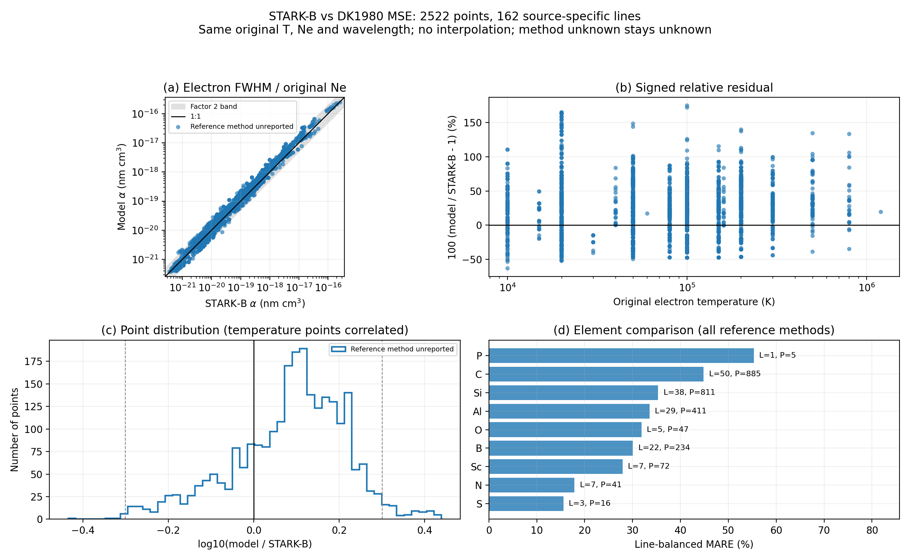

# STARK-B 电子 FWHM 与修正半经验模型比较

生成时间（UTC）：2026-11-04T07:43:02.666377+00:00。

## 输入范围与采集完整性

STARK manifest：`D:\LIBS\SimLIBS\simLIBS-2.0.3\stark-b\manifest.json`；SHA-256：`a76a9768b80be6b4565e2272739e957156351cad5d6c8b99a3b85ef9633ae9eb`。读取状态 available，scope=all，complete=False，filters=`{"charges": null, "elements": null}`。

**本次不能声称完整加载 STARK-B 全库。** 筛选范围、不完整采集或加载时跳过的物种均不纳入已加载数据的覆盖率分母，请结合下列记录解释结果。

本次 --allow-partial=True。允许 partial 是读取策略，不改变 manifest 声明的范围和完整性；即使 complete=True，scope=filtered 仍是筛选子集。

`--elements` 与 `--charges` 只用于 fetch-stark；compare/fetch-atomic 不进一步筛选缓存。实际比较读取指定缓存的所有表，仅 q=2/3 可以计算，其余记录写入 skipped.csv。本次 CLI 抓取范围参数为 `{"elements": null, "charges": null, "refresh": false, "delay_seconds": 1.0}`。

sample manifest：`D:\LIBS\SimLIBS\simLIBS-2.0.3\sample\manifest.json`；SHA-256：`5a4613bb03da3da247f10d75bee1ee734ab0923759ba055e7481515e59c4acc0`。读取状态 available，scope=unknown，filters=`null`，complete=False。其 complete 仅描述原子来源采集，不意味着每条谱线都满足严格模型输入要求。手工覆盖后的输入状态为 `{"missing": 3752, "ready": 162}`，质量层为 `{"unknown": 3752, "nist-aki-complete": 162}`。

STARK manifest 报告的失败/未完成记录数：10。

| 阶段或物种 | 状态/原因 |
|---|---|
| species | ValueError: Request total time exceeds 120 seconds; no partial data retained |
| species | ValueError: Request total time exceeds 120 seconds; no partial data retained |
| species | ValueError: XSAMS value must be finite and positive |
| species | ValueError: XSAMS value must be finite and positive |
| species | ValueError: Request total time exceeds 120 seconds; no partial data retained |
| species | ValueError: Request total time exceeds 120 seconds; no partial data retained |
| species | ValueError: Request total time exceeds 120 seconds; no partial data retained |
| species | ValueError: XSAMS value must be finite and positive |
| species | HTTPError: 400 Client Error: Bad Request for url: https://stark-b.obspm.fr/12.07/vamdc/tap/sync?REQUEST=doQuery&LANG=VSS2&FORMAT=XSAMS&QUERY=SELECT+ALL+WHERE+AtomSymbol+%3D+%27Pb%27+AND+IonCharge+%3D+3+AND+EnvironmentTotalNumberDensity+%3E%3D+1e-300 |
| species | ValueError: XSAMS value must be finite and positive |

原子数据 manifest 报告的失败/未完成记录数：2。

| 阶段或物种 | 状态/原因 |
|---|---|
| Co q=2 | No usable resolved LS levels in NIST response |
| Mn q=2 | No usable resolved LS levels in NIST response |

manifest 与实际加载的数量差异/失败物种：

| 物种 | manifest 表/点 | 实际加载表/点 | 状态/原因 |
|---|---:|---:|---|
| Ba q=1 | 0 / 0 | 0 / 0 | ValueError: Request total time exceeds 120 seconds; no partial data retained |
| Ca q=0 | 0 / 0 | 0 / 0 | ValueError: Request total time exceeds 120 seconds; no partial data retained |
| Ca q=8 | 0 / 0 | 0 / 0 | ValueError: XSAMS value must be finite and positive |
| Cl q=6 | 0 / 0 | 0 / 0 | ValueError: XSAMS value must be finite and positive |
| He q=0 | 0 / 0 | 0 / 0 | ValueError: Request total time exceeds 120 seconds; no partial data retained |
| In q=1 | 0 / 0 | 0 / 0 | ValueError: Request total time exceeds 120 seconds; no partial data retained |
| Mg q=0 | 0 / 0 | 0 / 0 | ValueError: Request total time exceeds 120 seconds; no partial data retained |
| Mg q=10 | 0 / 0 | 0 / 0 | ValueError: XSAMS value must be finite and positive |
| Pb q=3 | 0 / 0 | 0 / 0 | HTTPError: 400 Client Error: Bad Request for url: https://stark-b.obspm.fr/12.07/vamdc/tap/sync?REQUEST=doQuery&LANG=VSS2&FORMAT=XSAMS&QUERY=SELECT+ALL+WHERE+AtomSymbol+%3D+%27Pb%27+AND+IonCharge+%3D+3+AND+EnvironmentTotalNumberDensity+%3E%3D+1e-300 |
| Ti q=11 | 0 / 0 | 0 / 0 | ValueError: XSAMS value must be finite and positive |

加载器警告（包括 partial 模式跳过损坏物种）：

- RuntimeWarning: STARK-B manifest is incomplete: Ba q=1: failed (ValueError: Request total time exceeds 120 seconds; no partial data retained); Ca q=0: failed (ValueError: Request total time exceeds 120 seconds; no partial data retained); Ca q=8: failed (ValueError: XSAMS value must be finite and positive); Cl q=6: failed (ValueError: XSAMS value must be finite and positive); He q=0: failed (ValueError: Request total time exceeds 120 seconds; no partial data retained); In q=1: failed (ValueError: Request total time exceeds 120 seconds; no partial data retained); Mg q=0: failed (ValueError: Request total time exceeds 120 seconds; no partial data retained); Mg q=10: failed (ValueError: XSAMS value must be finite and positive); Pb q=3: failed (HTTPError: 400 Client Error: Bad Request for url: https://stark-b.obspm.fr/12.07/vamdc/tap/sync?REQUEST=doQuery&LANG=VSS2&FORMAT=XSAMS&QUERY=SELECT+ALL+WHERE+AtomSymbol+%3D+%27Pb%27+AND+IonCharge+%3D+3+AND+EnvironmentTotalNumberDensity+%3E%3D+1e-300); Ti q=11: failed (ValueError: XSAMS value must be finite and positive)
- RuntimeWarning: Skipping STARK-B species Ba q=1: failed: ValueError: Request total time exceeds 120 seconds; no partial data retained
- RuntimeWarning: Skipping STARK-B species Ca q=0: failed: ValueError: Request total time exceeds 120 seconds; no partial data retained
- RuntimeWarning: Skipping STARK-B species Ca q=8: failed: ValueError: XSAMS value must be finite and positive
- RuntimeWarning: Skipping STARK-B species Cl q=6: failed: ValueError: XSAMS value must be finite and positive
- RuntimeWarning: Skipping STARK-B species He q=0: failed: ValueError: Request total time exceeds 120 seconds; no partial data retained
- RuntimeWarning: Skipping STARK-B species In q=1: failed: ValueError: Request total time exceeds 120 seconds; no partial data retained
- RuntimeWarning: Skipping STARK-B species Mg q=0: failed: ValueError: Request total time exceeds 120 seconds; no partial data retained
- RuntimeWarning: Skipping STARK-B species Mg q=10: failed: ValueError: XSAMS value must be finite and positive
- RuntimeWarning: Skipping STARK-B species Pb q=3: failed: HTTPError: 400 Client Error: Bad Request for url: https://stark-b.obspm.fr/12.07/vamdc/tap/sync?REQUEST=doQuery&LANG=VSS2&FORMAT=XSAMS&QUERY=SELECT+ALL+WHERE+AtomSymbol+%3D+%27Pb%27+AND+IonCharge+%3D+3+AND+EnvironmentTotalNumberDensity+%3E%3D+1e-300
- RuntimeWarning: Skipping STARK-B species Ti q=11: failed: ValueError: XSAMS value must be finite and positive

summary.json 的 run 字段保留两个 manifest 的完整内容及 SHA-256、加载物种计数、全部失败、加载警告与数量差异。

## 数据与覆盖率

读取 9034 张表、50364 个原始点、3914 条含数据集与来源身份的谱线。成功比较 2522 点、162 条线；跳过 47842 点，另有 0 条表级异常、0 条运行级异常。

全部输入的点覆盖率 5.01%，谱线覆盖率 4.14%。q=2/3 子集有 16571 点、1381 条线，对应覆盖率为 15.22%、11.73%。这些是已加载数据的覆盖率，不能替代抓取 manifest 对全库完整性的证明。

## 误差与数据所支持的结论

| 指标 | 每点等权 | 每条谱线等权 |
|---|---:|---:|
| MARE（%） | 36.2 | 35.8 |
| 绝对相对误差中位数（%） | 30.5 | 30.5 |
| 平均有符号偏差（%） | 27 | 26.9 |
| 相对误差 RMS（%） | 45.4 | 44.8 |
| log10 比值均值 | 0.085 | 0.0852 |
| log10 比值中位数 | 0.1 | 0.0994 |
| log10 误差 RMS（dex） | 0.157 | 0.154 |
| 比值几何均值 | 1.22 | 1.22 |
| 两倍以内比例 | 0.971 | 0.974 |

在当前成功子集中，每线等权 MARE 为 35.8%，绝对相对误差中位数为 30.5%，有符号偏差为 26.9%（平均高估）。两倍以内的加权比例为 97.40%，log10 误差 RMS 为 0.154 dex。有符号均值存在抵消，不能替代绝对误差。

每线等权表示一条完整身份谱线总权重为 1，线内每个原始 T、Ne 点的权重为 1/n。每点等权会让采样较密的线贡献更多；二者同时保留，不把温度点视作独立实验。线的身份包含来源与数据集，同一物理跃迁的不同出版物会分开统计。

## 元素分层

| 组 | 比较点 / 输入点 | 比较线 / 输入线 | 每线 MARE（%） | 每线偏差（%） |
|---|---:|---:|---:|---:|
| Ag | 0 / 1243 | 0 / 54 | 不可计算 | 不可计算 |
| Al | 411 / 1168 | 29 / 71 | 33.5 | 31.7 |
| Ar | 0 / 784 | 0 / 134 | 不可计算 | 不可计算 |
| As | 0 / 108 | 0 / 18 | 不可计算 | 不可计算 |
| Au | 0 / 203 | 0 / 14 | 不可计算 | 不可计算 |
| B | 234 / 3273 | 22 / 213 | 30.1 | 18.5 |
| Ba | 0 / 216 | 0 / 14 | 不可计算 | 不可计算 |
| Be | 0 / 2478 | 0 / 124 | 不可计算 | 不可计算 |
| Bi | 0 / 215 | 0 / 36 | 不可计算 | 不可计算 |
| Br | 0 / 80 | 0 / 14 | 不可计算 | 不可计算 |
| C | 885 / 4549 | 50 / 297 | 44.8 | 37.4 |
| Ca | 0 / 1888 | 0 / 84 | 不可计算 | 不可计算 |
| Cd | 0 / 1767 | 0 / 163 | 不可计算 | 不可计算 |
| Cl | 0 / 100 | 0 / 20 | 不可计算 | 不可计算 |
| Co | 0 / 387 | 0 / 72 | 不可计算 | 不可计算 |
| Cr | 0 / 150 | 0 / 25 | 不可计算 | 不可计算 |
| Cu | 0 / 117 | 0 / 21 | 不可计算 | 不可计算 |
| Eu | 0 / 48 | 0 / 8 | 不可计算 | 不可计算 |
| F | 0 / 843 | 0 / 104 | 不可计算 | 不可计算 |
| Fe | 0 / 42 | 0 / 9 | 不可计算 | 不可计算 |
| Ga | 0 / 168 | 0 / 28 | 不可计算 | 不可计算 |
| Ge | 0 / 261 | 0 / 36 | 不可计算 | 不可计算 |
| Hg | 0 / 42 | 0 / 7 | 不可计算 | 不可计算 |
| I | 0 / 74 | 0 / 13 | 不可计算 | 不可计算 |
| In | 0 / 433 | 0 / 20 | 不可计算 | 不可计算 |
| K | 0 / 2057 | 0 / 85 | 不可计算 | 不可计算 |
| Kr | 0 / 518 | 0 / 62 | 不可计算 | 不可计算 |
| La | 0 / 54 | 0 / 9 | 不可计算 | 不可计算 |
| Li | 0 / 1598 | 0 / 103 | 不可计算 | 不可计算 |
| Lu | 0 / 108 | 0 / 27 | 不可计算 | 不可计算 |
| Mg | 0 / 1088 | 0 / 77 | 不可计算 | 不可计算 |
| Mn | 0 / 144 | 0 / 24 | 不可计算 | 不可计算 |
| N | 41 / 613 | 7 / 64 | 17.9 | -14.6 |
| Na | 0 / 2551 | 0 / 141 | 不可计算 | 不可计算 |
| Nb | 0 / 90 | 0 / 15 | 不可计算 | 不可计算 |
| Ne | 0 / 2033 | 0 / 205 | 不可计算 | 不可计算 |
| Ni | 0 / 12 | 0 / 2 | 不可计算 | 不可计算 |
| O | 47 / 1781 | 5 / 108 | 31.9 | -31.9 |
| P | 5 / 3930 | 1 / 173 | 55.3 | 55.3 |
| Pd | 0 / 18 | 0 / 3 | 不可计算 | 不可计算 |
| Pt | 0 / 20 | 0 / 4 | 不可计算 | 不可计算 |
| Ra | 0 / 318 | 0 / 53 | 不可计算 | 不可计算 |
| Rb | 0 / 347 | 0 / 28 | 不可计算 | 不可计算 |
| S | 16 / 1017 | 3 / 65 | 15.6 | -1.03 |
| Sb | 0 / 102 | 0 / 17 | 不可计算 | 不可计算 |
| Sc | 72 / 422 | 7 / 31 | 27.9 | 27.9 |
| Se | 0 / 341 | 0 / 34 | 不可计算 | 不可计算 |
| Si | 811 / 3521 | 38 / 223 | 35.3 | 30.9 |
| Sn | 0 / 12 | 0 / 2 | 不可计算 | 不可计算 |
| Sr | 0 / 534 | 0 / 45 | 不可计算 | 不可计算 |
| Te | 0 / 24 | 0 / 4 | 不可计算 | 不可计算 |
| Ti | 0 / 2348 | 0 / 362 | 不可计算 | 不可计算 |
| Tl | 0 / 47 | 0 / 2 | 不可计算 | 不可计算 |
| V | 0 / 1736 | 0 / 111 | 不可计算 | 不可计算 |
| Xe | 0 / 578 | 0 / 84 | 不可计算 | 不可计算 |
| Y | 0 / 689 | 0 / 38 | 不可计算 | 不可计算 |
| Zn | 0 / 698 | 0 / 54 | 不可计算 | 不可计算 |
| Zr | 0 / 378 | 0 / 60 | 不可计算 | 不可计算 |

## 电荷分层

| 组 | 比较点 / 输入点 | 比较线 / 输入线 | 每线 MARE（%） | 每线偏差（%） |
|---|---:|---:|---:|---:|
| 0 | 0 / 9423 | 0 / 645 | 不可计算 | 不可计算 |
| 10 | 0 / 616 | 0 / 27 | 不可计算 | 不可计算 |
| 11 | 0 / 168 | 0 / 9 | 不可计算 | 不可计算 |
| 12 | 0 / 2580 | 0 / 94 | 不可计算 | 不可计算 |
| 1 | 0 / 9472 | 0 / 1019 | 不可计算 | 不可计算 |
| 2 | 763 / 7092 | 66 / 808 | 30.5 | 22.3 |
| 3 | 1759 / 9479 | 96 / 573 | 39.5 | 30 |
| 4 | 0 / 4256 | 0 / 323 | 不可计算 | 不可计算 |
| 5 | 0 / 1731 | 0 / 133 | 不可计算 | 不可计算 |
| 6 | 0 / 663 | 0 / 36 | 不可计算 | 不可计算 |
| 7 | 0 / 1245 | 0 / 100 | 不可计算 | 不可计算 |
| 8 | 0 / 993 | 0 / 38 | 不可计算 | 不可计算 |
| 9 | 0 / 2646 | 0 / 109 | 不可计算 | 不可计算 |

## 原子数据质量分层

| 组 | 比较点 / 输入点 | 比较线 / 输入线 | 每线 MARE（%） | 每线偏差（%） |
|---|---:|---:|---:|---:|
| nist-aki-complete | 2522 / 2608 | 162 / 162 | 35.8 | 26.9 |
| unknown | 0 / 47756 | 0 / 3752 | 不可计算 | 不可计算 |

## 参考方法分层

| 组 | 比较点 / 输入点 | 比较线 / 输入线 | 每线 MARE（%） | 每线偏差（%） |
|---|---:|---:|---:|---:|
| unreported | 2522 / 50364 | 162 / 3914 | 35.8 | 26.9 |

## 来源与报告方法分层

| 组 | 比较点 / 输入点 | 比较线 / 输入线 | 每线 MARE（%） | 每线偏差（%） |
|---|---:|---:|---:|---:|
| Ben Nessib N. Ben Lakhdar Z. Sahal-Bréchot S. Stark Broadening of Oxygen lines in the impact and quasistatic approximation journal 1996 Phys.Scr. 54 https://ui.adsabs.harvard.edu/abs/1996PhyS...54..608B/abstract；unreported | 0 / 16 | 0 / 4 | 不可计算 | 不可计算 |
| Ben Nessib N. Dimitrijević M.S. Sahal-Bréchot S. Stark broadening of the four times ionized Silicon spectral lines journal 2004 A&A 423 http://cdsads.u-strasbg.fr/abs/2004A%26A...423..397B；unreported | 0 / 192 | 0 / 32 | 不可计算 | 不可计算 |
| Blagojević B. Popović M. V. Konjević N. Dimitrijević M. S. Plasma broadening and shifting of spectral lines along the isoelectronic sequence of boron journal 1996 Phys.Rev.E 54 http://cdsads.u-strasbg.fr/abs/1996PhRvE..54..743B；unreported | 48 / 108 | 8 / 18 | 24.1 | -24.1 |
| Blagojević B. Popović M. V. Konjević N. Dimitrijević M. S. Stark Broadening Parameters of Analogous Spectral Lines Along the Lithium and Beryllium Isoelectronic Sequences journal 1999 JQSRT 61 http://cdsads.u-strasbg.fr/abs/1999JQSRT..61..361B \| Dimitrijevic M. S. Stark Broadening Data Tables for Some Analogous Spectral Lines Along Li and Be Isoelectronic Sequences journal 1999 Serb. Astron. J. 159 http://cdsads.u-strasbg.fr/abs/1999SerAJ.159...65D；unreported | 11 / 44 | 2 / 9 | 17.9 | -13.9 |
| Christova M. Dimitrijević M. S Simić Z. and S Sahal-Bréchot S. Stark Broadening Parameters of Ne I 837.8 nm Spectral Line journal 2010 J. Phys. Conf. Ser. 207 http://cdsads.u-strasbg.fr/abs/2010JPhCS.207a2025C \| Dimitrijević M.S. Simić Z. Kovačević A. Valjarević A. S. Sahal-Bréchot S. Stark Widths of Spectral Lines of Neutral Neon journal 2015 JApA 36 http://cdsads.u-strasbg.fr.ezproxy.obspm.fr/abs/2015JApA...36..643；unreported | 0 / 180 | 0 / 30 | 不可计算 | 不可计算 |
| Csillag L. Dimitrijević M. S. On the Stark broadening of the 537.8 nm and 441.6 nm Cd+ lines excited in a hollow cathode laser discharge journal 2004 Appl. Phys. B Lasers and Optics 78 http://cdsads.u-strasbg.fr/abs/2004ApPhB..78..221C；unreported | 0 / 6 | 0 / 1 | 不可计算 | 不可计算 |
| Dimitrijevic M. S. Stark Broadening of Ne II and Ne III Spectral Lines journal 2003 J. Appl. Spectr. 70 http://cdsads.u-strasbg.fr/abs/2003JAS....70..493D \| Dimitrijevic M. S. Stark Broadening of Ne II and Ne III Spectral Lines journal 2003 Zh PS. 70 https://www.researchgate.net/publication/227072987_Stark_broadening_of_Ne_II_and_Ne_III_spectral_lines \| Dimitrijevic M. S. Stark Broadening Parameter Tables for Ne II and Ne III Spectral Lines journal 2001 Serb. Astron. J. 164 http://cdsads.u-strasbg.fr/abs/2001SerAJ.164...57D \| Milosavljević V. Dimitrijević M. S. Djeniže S. Stark Widths of the Ne II, Ne III, and Ne IV Spectral Lines journal 2001 ApJS 135 http://cdsads.u-strasbg.fr/abs/2001ApJS..135..115M \| Dimitrijević M. S. Kovačević A. Simić Z. Sahal-Bréchot S. Stark Broadening of Several Ne II, Ne III and O III Spectral Lines for the Stark-B Database journal 2011 Baltic Astr. 20 http://cdsads.u-strasbg.fr/abs/2011BaltA..20..580D；unreported | 0 / 478 | 0 / 37 | 不可计算 | 不可计算 |
| Dimitrijevic M. S. Stark Broadening of Ne II and Ne III Spectral Lines journal 2003 J. Appl. Spectr. 70 http://cdsads.u-strasbg.fr/abs/2003JAS....70..493D \| Dimitrijevic M. S. Stark Broadening of Ne II and Ne III Spectral Lines journal 2003 Zh PS. 70 https://www.researchgate.net/publication/227072987_Stark_broadening_of_Ne_II_and_Ne_III_spectral_lines \| Dimitrijevic M. S. Stark Broadening Parameter Tables for Ne II and Ne III Spectral Lines journal 2001 Serb. Astron. J. 164 http://cdsads.u-strasbg.fr/abs/2001SerAJ.164...57D；unreported | 0 / 239 | 0 / 16 | 不可计算 | 不可计算 |
| Dimitrijevic M. S. Stark Broadening of Ne II and Ne III Spectral Lines journal 2003 J. Appl. Spectr. 70 http://cdsads.u-strasbg.fr/abs/2003JAS....70..493D \| Dimitrijevic M. S. Stark Broadening of Ne II and Ne III Spectral Lines journal 2003 Zh PS. 70 https://www.researchgate.net/publication/227072987_Stark_broadening_of_Ne_II_and_Ne_III_spectral_lines；unreported | 0 / 308 | 0 / 20 | 不可计算 | 不可计算 |
| Dimitrijević M. S. Christova M. Simić Z. Kovačević A. Sahal-Bréchot S. Stark broadening of B IV spectral lines journal 2016 MNRAS 460 http://cdsads.u-strasbg.fr/abs/2016MNRAS.460.1658D；unreported | 0 / 2886 | 0 / 177 | 不可计算 | 不可计算 |
| Dimitrijević M. S. Djurić Z. Mihajlov A. A. Stark broadening of Al III and Cu IV lines for diagnostic of the rail gun arc plasma journal 1994 J.Phys.D 27 http://cdsads.u-strasbg.fr/abs/1994JPhD...27..247D；unreported | 0 / 36 | 0 / 6 | 不可计算 | 不可计算 |
| Dimitrijević M. S. Electron-impact widths of doubly and triply charged ion lines of astrophysical importance journal 1988 A&AS 76 http://cdsads.u-strasbg.fr/abs/1988A%26AS...76...53D \| Dimitrijević M. S. Konjević N. Modified Semiempirical Formula for the Electron-Impact Width of Ionized Atom Lines: Theory and Applications journal 1981 5th ICSLS Conf. Proc. http://cdsads.u-strasbg.fr/abs/1981sls..conf..211D；unreported | 10 / 140 | 2 / 28 | 33.3 | 33.3 |
| Dimitrijević M. S. Electron-impact widths of doubly and triply charged ion lines of astrophysical importance journal 1988 A&AS 76 http://cdsads.u-strasbg.fr/abs/1988A%26AS...76...53D \| Dimitrijević M. S. Konjević N. Stark widths of doubly- and triply-ionized atom lines journal 1980 JQSRT 24 http://cdsads.u-strasbg.fr/abs/1980JQSRT..24..451D \| Dimitrijević M. S. Konjević N. Modified Semiempirical Formula for the Electron-Impact Width of Ionized Atom Lines: Theory and Applications journal 1981 5th ICSLS Conf. Proc. http://cdsads.u-strasbg.fr/abs/1981sls..conf..211D；unreported | 40 / 215 | 8 / 43 | 34.6 | 34.4 |
| Dimitrijević M. S. Electron-impact widths of doubly and triply charged ion lines of astrophysical importance journal 1988 A&AS 76 http://cdsads.u-strasbg.fr/abs/1988A%26AS...76...53D \| Dimitrijević M. S. Konjević N. Stark widths of doubly- and triply-ionized atom lines journal 1980 JQSRT 24 http://cdsads.u-strasbg.fr/abs/1980JQSRT..24..451D；unreported | 24 / 34 | 5 / 7 | 9.9 | 9.83 |
| Dimitrijević M. S. Electron-impact widths of doubly and triply charged ion lines of astrophysical importance journal 1988 A&AS 76 http://cdsads.u-strasbg.fr/abs/1988A%26AS...76...53D \| Simić Z. Dimitrijević M. S. Popović L. Č. Dacić M. D. Stark Broadening of F III Lines in Laboratory and Stellar Plasma journal 2005 J Appl. Spectr. 72 http://cdsads.u-strasbg.fr/abs/2005JAS....72..443S；unreported | 0 / 85 | 0 / 15 | 不可计算 | 不可计算 |
| Dimitrijević M. S. Electron-impact widths of doubly and triply charged ion lines of astrophysical importance journal 1988 A&AS 76 http://cdsads.u-strasbg.fr/abs/1988A%26AS...76...53D；unreported | 40 / 180 | 8 / 36 | 25.6 | 25.6 |
| Dimitrijević M. S. Electron-impact widths of four- and five-times charged ion lines of astrophysical importance journal 1993 A&AS 100 http://cdsads.u-strasbg.fr/abs/1993A%26AS..100..237D；unreported | 0 / 390 | 0 / 78 | 不可计算 | 不可计算 |
| Dimitrijević M. S. Konjević N. On the Stark broadening of ionized nitrogen lines journal 1981 JQSRT 25 http://cdsads.u-strasbg.fr.ezproxy.obspm.fr/abs/1981JQSRT..25..387D；unreported | 0 / 20 | 0 / 5 | 不可计算 | 不可计算 |
| Dimitrijević M. S. Popović L. Č. Stark Broadening Parameters for Stellar Plasma Research: Bi III Spectral Line journal 1998 Proc.the 29th Stellar Conf. on Variable Star Research, Dusek, J., Zejda, M. (eds.), N. Copernicus Observatory and Planetarium Brno http://cdsads.u-strasbg.fr/abs/1998vsr..conf...56D；unreported | 0 / 35 | 0 / 5 | 不可计算 | 不可计算 |
| Dimitrijević M. S. Popović L.Č. Stark broadening of Bi II lines of astrophysical interest journal 1993 A&AS 101 http://cdsads.u-strasbg.fr.ezproxy.obspm.fr/abs/1993A%26AS..101..583D；unreported | 0 / 156 | 0 / 27 | 不可计算 | 不可计算 |
| Dimitrijević M. S. Stark broadening of the Fe II lines in the solar and stellar spectra journal 1988 ASSL (Proc. 94th IAU Coll.) 138 http://cdsads.u-strasbg.fr/abs/1988ASSL..138..211D；unreported | 0 / 24 | 0 / 6 | 不可计算 | 不可计算 |
| Dimitrijević M.S. Christova C. Sahal-Bréchot S Stark broadening of visible Ar I spectral lines journal 2007 Phys.Scr. 75 http://cdsads.u-strasbg.fr/abs/2007PhyS...75..809D \| Christova M. Dimitrijević M. S. Kovačević A Similarities in calculated Stark broadening parameters of argon spectral lines journal 2010 J. Phys. Conf. Ser. 207 http://cdsads.u-strasbg.fr/abs/2010JPhCS.207a2024C \| Milosavljević V. Dimitrijević M. S. Djeniže S. Measured and calculated Stark parameters for several Ar I spectral lines journal 2003 High Temp.Material Processes 7 http://www.begellhouse.com/journals/57d172397126f956.html?vol=7 \| Dimitrijević M. S. Skuljan Lj. Djeniže S. Stark Broadening of the Ar I Spectral Lines 763.51, 738.39 and 696.54 nm journal 2002 Phys. Scr. 66 http://cdsads.u-strasbg.fr/abs/2002PhyS...66...77D \| Dimitrijević M. S. Kovačević A. Simić Z. Sahal-Bréchot S. Stark broadening of Ar I spectral lines in the visible part of the spectrum journal 2011 Baltic Astr 20 http://cdsads.u-strasbg.fr/abs/2011BaltA..20..576D；unreported | 0 / 197 | 0 / 24 | 不可计算 | 不可计算 |
| Dimitrijević M.S. Christova M.D. Yubero C. Stark broadening data for Si II multiplets within 3s3p(3Po)nl configuration journal 2023 Advances Space Res. 71 https://ui.adsabs.harvard.edu/abs/2023AdSpR..71.1275D；unreported | 0 / 65 | 0 / 13 | 不可计算 | 不可计算 |
| Dimitrijević M.S. Csillag L. Spectral line broadening influence on the mode structure of the He-Kr and He-Ar Gas lasers journal 2006 J.Appl.Spectr. 73 http://cdsads.u-strasbg.fr/abs/2006JApSp..73..458D \| Dimitrijević M.S. Csillag L. Spectral line broadening influence on the mode structure of the He-Kr and He-Ar Gas lasers journal 2006 ZhPS 73 http://imaph.bas-net.by/JAS/engl/library/7303/cont7303.html \| Dimitrijević M. S. Truong Bach On the Stark Broadening of Single Ionized Argon Lines journal 1986 Z.Naturforsch. A 41 http://cdsads.u-strasbg.fr/abs/1986ZNatA..41..772D；unreported | 0 / 77 | 0 / 15 | 不可计算 | 不可计算 |
| Dimitrijević M.S. Csillag L. Spectral line broadening influence on the mode structure of the He-Kr and He-Ar Gas lasers journal 2006 J.Appl.Spectr. 73 http://cdsads.u-strasbg.fr/abs/2006JApSp..73..458D \| Dimitrijević M.S. Csillag L. Spectral line broadening influence on the mode structure of the He-Kr and He-Ar Gas lasers journal 2006 ZhPS 73 http://imaph.bas-net.by/JAS/engl/library/7303/cont7303.html；unreported | 0 / 6 | 0 / 1 | 不可计算 | 不可计算 |
| Dimitrijević M.S. Sahal-Bréchot S. . Stark broadening parameter tables for Ar VIII journal 1999 Serb. Astron. J. 160 http://cdsads.u-strasbg.fr/abs/1999SerAJ.160...15D；unreported | 0 / 225 | 0 / 9 | 不可计算 | 不可计算 |
| Dimitrijević M.S. Sahal-Bréchot S. Bommier V. Stark broadening of spectral lines of multicharged ions of astrophysical interest. I: C IV lines journal 1991 A&AS 89 http://cdsads.u-strasbg.fr/abs/1991A%26AS...89..581D \| Dimitrijević M.S. Sahal-Bréchot S. Bommier V. Stark broadening parameters tables for spectral lines of multicharged ions of astrophysical interest. I: C IV lines journal 1991 Bull. Obs. Astron. Belgrade 144 http://cdsads.u-strasbg.fr/abs/1991BOBeo.144...65D \| Dimitrijević M.S. Sahal-Bréchot S. Stark broadening parameters tables for large quantum number. C IV UV lines of interest for Extreme Ultraviolet Explorer Mission journal 1992 Bull. Obs. Astron. Belgrade 146 http://cdsads.u-strasbg.fr/abs/1992BABel.146..105D \| Dimitrijević M.S. Influence of different collisional processes on the Stark broadening within spectral series : the O VI case journal 1992 Bull. Obs. Astron. Belgrade 146 http://cdsads.u-strasbg.fr/abs/1992BABel.146..115D；unreported | 856 / 1751 | 44 / 101 | 49.5 | 41.7 |
| Dimitrijević M.S. Sahal-Bréchot S. Bommier V. Stark broadening of spectral lines of multicharged ions of astrophysical interest. II: Si IV lines. journal 1991 A&AS 89 http://cdsads.u-strasbg.fr/abs/1991A%26AS...89..591D \| Dimitrijević M.S. Sahal-Bréchot S. Bommier V. Stark broadening parameters tables for spectral lines of multicharged ions of astrophysical interest. II: Si IV lines journal 1991 Bull. Obs. Astron. Belgrade 144 http://cdsads.u-strasbg.fr/abs/1991BOBeo.144...81D；unreported | 791 / 908 | 34 / 40 | 34.8 | 29.8 |
| Dimitrijević M.S. Sahal-Bréchot S. Stark broadening of Ag I spectral lines journal 2003 ADNDT 85 http://cdsads.u-strasbg.fr/abs/2003ADNDT..85..269D；unreported | 0 / 1207 | 0 / 48 | 不可计算 | 不可计算 |
| Dimitrijević M.S. Sahal-Bréchot S. Stark broadening of Ba I and Ba II spectral lines journal 1997 A&AS 122 http://cdsads.u-strasbg.fr/abs/1997A%26AS..122..163D \| Dimitrijević M.S. Sahal-Bréchot S. Stark broadening parameters tables for Ba I and Ba II journal 1996 Bull. Astron. Belgrade 154 http://cdsads.u-strasbg.fr/abs/1996BABel.154...61D；unreported | 0 / 216 | 0 / 14 | 不可计算 | 不可计算 |
| Dimitrijević M.S. Sahal-Bréchot S. Stark broadening of Be I spectral lines journal 1994 A&AS 105 http://cdsads.u-strasbg.fr/abs/1994A%26AS..105..243D \| Dimitrijević M.S. Sahal-Bréchot S. Stark broadening parameters tables for Be I lines of astrophysical interest (addendum to Bull. Astron. Belgrade 146, 73, 1992) journal 1993 Bull. Astron. Belgrade 148 http://cdsads.u-strasbg.fr/abs/1993BABel.148...65D；unreported | 0 / 418 | 0 / 28 | 不可计算 | 不可计算 |
| Dimitrijević M.S. Sahal-Bréchot S. Stark broadening of Li I lines journal 1991 JQSRT 46 http://cdsads.u-strasbg.fr/abs/1991JQSRT..46...41D \| Dimitrijević M.S. Sahal-Bréchot S. Broadening of of LiI lines by collisions with charged particles journal 1991 Bull. Obs. Astron. Belgrade 143 http://cdsads.u-strasbg.fr/abs/1991BOBeo.143...29D \| Dimitrijević M. S. Feautrier N. Sahal-Bréchot S. Comparison between quantum and semiclassical calculations of the electron impact broadening of the Li I resonance line journal 1981 J. Phys. B: At. Mol. Phys. 14 http://cdsads.u-strasbg.fr/abs/1981JPhB...14.2559D；unreported | 0 / 1115 | 0 / 62 | 不可计算 | 不可计算 |
| Dimitrijević M.S. Sahal-Bréchot S. Stark broadening of Sr I spectral lines journal 1996 A&AS 119 http://cdsads.u-strasbg.fr/abs/1996A%26AS..119..529D \| Dimitrijević M.S. Sahal-Bréchot S. Stark broadening parameters tables for Sr I journal 1996 Bull. Astron. Belgrade 153 http://cdsads.u-strasbg.fr/abs/1996BABel.153...89D；unreported | 0 / 504 | 0 / 40 | 不可计算 | 不可计算 |
| Dimitrijević M.S. Sahal-Bréchot S. Stark broadening of V V and V XIII spectral lines journal 1998 ADNDT 68 http://cdsads.u-strasbg.fr/abs/1998ADNDT..68..241D；unreported | 0 / 1454 | 0 / 59 | 不可计算 | 不可计算 |
| Dimitrijević M.S. Sahal-Bréchot S. Stark broadening of neutral potassium lines journal 1987 JQSRT 38 http://cdsads.u-strasbg.fr/abs/1987JQSRT..38...37D \| Dimitrijević M.S. Sahal-Bréchot S. Stark broadening of K I lines journal 1990 Bull. Obs. Astron. Belgrade 142 http://cdsads.u-strasbg.fr/abs/1990BOBeo.142...29D；unreported | 0 / 1086 | 0 / 51 | 不可计算 | 不可计算 |
| Dimitrijević M.S. Sahal-Bréchot S. Stark broadening of neutral sodium lines journal 1985 JQSRT 34 http://cdsads.u-strasbg.fr/abs/1985JQSRT..34..149D \| Dimitrijević M.S. Sahal-Bréchot S. Stark broadening of Na I lines with principal quantum number between 6 and 10 journal 1990 JQSRT 44 http://cdsads.u-strasbg.fr/abs/1990JQSRT..44..421D \| Dimitrijević M.S. Sahal-Bréchot S. Tables for Na I lines Stark broadening parameters journal 1990 Bull. Obs. Astron. Belgrade 142 http://cdsads.u-strasbg.fr/abs/1990BOBeo.142...59D；unreported | 0 / 906 | 0 / 61 | 不可计算 | 不可计算 |
| Dimitrijević M.S. Sahal-Bréchot S. Stark broadening of neutral zinc spectral lines journal 1999 A&AS 140 http://cdsads.u-strasbg.fr/abs/1999A%26AS..140..193D \| Dimitrijević M.S. Sahal-Bréchot S. Stark broadening parameter tables for neutral Zinc spectral lines journal 1999 Serb. Astron. J. 160 http://cdsads.u-strasbg.fr/abs/1999SerAJ.160...21D；unreported | 0 / 590 | 0 / 36 | 不可计算 | 不可计算 |
| Dimitrijević M.S. Sahal-Bréchot S. Stark broadening of spectral lines of multicharged ions of astrophysical interest XXII: K VIII and K IX spectral lines journal 1998 A&AS 133 http://cdsads.u-strasbg.fr/abs/1998A%26AS..133..227D \| Dimitrijević M.S. Sahal-Bréchot S. Stark broadening parameters tables for K VIII and K IX journal 1998 Serb. Astron. J. 158 http://cdsads.u-strasbg.fr/abs/1998SerAJ.158..103D；unreported | 0 / 971 | 0 / 34 | 不可计算 | 不可计算 |
| Dimitrijević M.S. Sahal-Bréchot S. Stark broadening of spectral lines of multicharged ions of astrophysical interest. III: O VI lines journal 1992 A&AS 93 http://cdsads.u-strasbg.fr/abs/1992A%26AS...93..359D \| Dimitrijević M.S. Influence of different collisional processes on the Stark broadening within spectral series : the O VI case journal 1992 Bull. Obs. Astron. Belgrade 146 http://cdsads.u-strasbg.fr/abs/1992BABel.146..115D \| Blagojević B. Popović M. V. Konjević N. Dimitrijević M. S. Stark Broadening Parameters of Analogous Spectral Lines Along the Lithium and Beryllium Isoelectronic Sequences journal 1999 JQSRT 61 http://cdsads.u-strasbg.fr/abs/1999JQSRT..61..361B；unreported | 0 / 858 | 0 / 30 | 不可计算 | 不可计算 |
| Dimitrijević M.S. Sahal-Bréchot S. Stark broadening of spectral lines of multicharged ions of astrophysical interest. IV: N V lines journal 1992 A&AS 95 http://cdsads.u-strasbg.fr/abs/1992A%26AS...95..109D；unreported | 0 / 459 | 0 / 35 | 不可计算 | 不可计算 |
| Dimitrijević M.S. Sahal-Bréchot S. Stark broadening of spectral lines of multicharged ions of astrophysical interest. IX : F VII lines journal 1993 A&AS 101 http://cdsads.u-strasbg.fr/abs/1993A%26AS..101..587D；unreported | 0 / 341 | 0 / 20 | 不可计算 | 不可计算 |
| Dimitrijević M.S. Sahal-Bréchot S. Stark broadening of spectral lines of multicharged ions of astrophysical interest. V: Sc III and Ti IV lines journal 1992 A&AS 95 http://cdsads.u-strasbg.fr/abs/1992A%26AS...95..121D；unreported | 72 / 252 | 7 / 21 | 27.9 | 27.9 |
| Dimitrijević M.S. Sahal-Bréchot S. Stark broadening of spectral lines of multicharged ions of astrophysical interest. VII : Al III lines journal 1993 A&AS 99 http://cdsads.u-strasbg.fr/abs/1993A%26AS...99..585D \| Dimitrijević M.S. Sahal-Bréchot S. Stark broadening parameters tables for Al III lines journal 1993 Bull. Astron. Belgrade 147 http://cdsads.u-strasbg.fr/abs/1993BABel.147...35D \| Dimitrijević M. S. Djurić Z. Mihajlov A. A. Stark broadening of Al III and Cu IV lines for diagnostic of the rail gun arc plasma journal 1994 J.Phys.D 27 http://cdsads.u-strasbg.fr/abs/1994JPhD...27..247D；unreported | 371 / 411 | 21 / 23 | 33.1 | 30.7 |
| Dimitrijević M.S. Sahal-Bréchot S. Stark broadening of spectral lines of multicharged ions of astrophysical interest. VIII : S VI lines journal 1993 A&AS 100 http://cdsads.u-strasbg.fr/abs/1993A%26AS..100...91D；unreported | 0 / 326 | 0 / 21 | 不可计算 | 不可计算 |
| Dimitrijević M.S. Sahal-Bréchot S. Stark broadening of spectral lines of multicharged ions of astrophysical interest. X : Ne VIII and Na IX journal 1994 A&AS 107 http://cdsads.u-strasbg.fr/abs/1994A%26AS..107..349D \| Dimitrijević M.S. Sahal-Bréchot S. Stark broadening parameters tables for Ne VIII and Na IX lines of astrophysical interest journal 1993 Bull. Astron. Belgrade 148 http://cdsads.u-strasbg.fr/abs/1993BABel.148...29D；unreported | 0 / 500 | 0 / 28 | 不可计算 | 不可计算 |
| Dimitrijević M.S. Sahal-Bréchot S. Stark broadening of spectral lines of multicharged ions of astrophysical interest. XI : Al XI and Si XII journal 1994 A&AS 105 http://cdsads.u-strasbg.fr/abs/1994A%26AS..105..245D \| Dimitrijević M.S. Sahal-Bréchot S. Stark broadening parameters tables for Al XI and Si XII lines of astrophysical interest journal 1994 Bull. Astron. Belgrade 148 http://cdsads.u-strasbg.fr/abs/1993BABel.148...21D；unreported | 0 / 308 | 0 / 16 | 不可计算 | 不可计算 |
| Dimitrijević M.S. Sahal-Bréchot S. Stark broadening of spectral lines of multicharged ions of astrophysical interest. XII : O IV and O V journal 1995 A&AS 109 http://cdsads.u-strasbg.fr/abs/1995A%26AS..109..551D \| Dimitrijević M.S. Sahal-Bréchot S. Stark broadening parameters tables for O IV and O V lines of astrophysical importance journal 1994 Bull. Astron. Belgrade 150 http://cdsads.u-strasbg.fr/abs/1994BABel.150...95D；unreported | 35 / 387 | 3 / 24 | 26.7 | -26.7 |
| Dimitrijević M.S. Sahal-Bréchot S. Stark broadening of spectral lines of multicharged ions of astrophysical interest. XIV: Be III and B III journal 1996 A&AS 119 http://cdsads.u-strasbg.fr/abs/1996A%26AS..119..369D \| Dimitrijević M.S. Sahal-Bréchot S. Stark broadening parameters tables for Be III and B III journal 1996 Bull. Astron. Belgrade 153 http://cdsads.u-strasbg.fr/abs/1996BABel.153..101D \| Dimitrijević M.S. Dačić M. Cvetković Z. Sahal-Bréchot S. Stark broadening parameter tables for Be III journal 2002 Serb. Astron. J. 165 http://cdsads.u-strasbg.fr/abs/2002SerAJ.165...67D \| Dimitrijević M.S. Dačić M. Cvetković Z. Sahal-Bréchot S. Stark broadening of spectral lines of multicharged ions of astrophysical interest. XXIII. Be III journal 2003 A&A 400 http://cdsads.u-strasbg.fr/abs/2003A%26A...400..791D；unreported | 0 / 1309 | 0 / 62 | 不可计算 | 不可计算 |
| Dimitrijević M.S. Sahal-Bréchot S. Stark broadening of spectral lines of multicharged ions of astrophysical interest. XIV: Be III and B III journal 1996 A&AS 119 http://cdsads.u-strasbg.fr/abs/1996A%26AS..119..369D \| Dimitrijević M.S. Sahal-Bréchot S. Stark broadening parameters tables for Be III and B III journal 1996 Bull. Astron. Belgrade 153 http://cdsads.u-strasbg.fr/abs/1996BABel.153..101D；unreported | 218 / 340 | 19 / 27 | 32.7 | 20.8 |
| Dimitrijević M.S. Sahal-Bréchot S. Stark broadening parameter tables for Kr VIII journal 1999 Serb. Astron. J. 159 http://cdsads.u-strasbg.fr/abs/1999SerAJ.159...73D \| Dimitrijević M.S. Sahal-Bréchot S. Stark broadening of F VI, Cl VII and Kr VIII spectral lines journal 2000 Phys.Scr. 61 http://cdsads.u-strasbg.fr/abs/2000PhyS...61..319D；unreported | 0 / 179 | 0 / 6 | 不可计算 | 不可计算 |
| Dimitrijević M.S. Sahal-Bréchot S. Stark broadening parameters tables for Al I lines of astrophysical interest journal 1992 Bull. Astron. Belgrade 146 http://cdsads.u-strasbg.fr/abs/1992BABel.146...83D \| Dimitrijević M.S. Sahal-Bréchot S. Stark broadening of Al I spectral lines journal 1994 Phys.Scr. 49 http://cdsads.u-strasbg.fr/abs/1994PhyS...49...34D；unreported | 0 / 550 | 0 / 25 | 不可计算 | 不可计算 |
| Dimitrijević M.S. Sahal-Bréchot S. Stark broadening parameters tables for Be II lines of astrophysical interest journal 1992 Bull. Obs. Astron. Belgrade 145 http://cdsads.u-strasbg.fr/abs/1992BABel.145...65D \| Dimitrijević M.S. Sahal-Bréchot S. Stark broadening of Be II spectral line journal 1992 JQSRT 48 http://cdsads.u-strasbg.fr/abs/1992JQSRT..48..397D；unreported | 0 / 731 | 0 / 30 | 不可计算 | 不可计算 |
| Dimitrijević M.S. Sahal-Bréchot S. Stark broadening parameters tables for C V and P V journal 1995 Bull. Astron. Belgrade 152 http://cdsads.u-strasbg.fr/abs/1995BABel.152...99D \| Dimitrijević M.S. Sahal-Bréchot S. Stark broadening of spectral lines of 3 multicharged ions of astrophysical interest. XIII : C V and P V journal 1996 A&AS 115 http://cdsads.u-strasbg.fr/abs/1996A%26AS..115..351D；unreported | 0 / 1479 | 0 / 78 | 不可计算 | 不可计算 |
| Dimitrijević M.S. Sahal-Bréchot S. Stark broadening parameters tables for Ca II lines of astrophysical interest journal 1992 Bull. Obs. Astron. Belgrade 145 http://cdsads.u-strasbg.fr/abs/1992BABel.145...83D \| Dimitrijević M.S. Sahal-Bréchot S.. Stark broadening of Ca II spectral lines journal 1993 JQSRT 49 http://cdsads.u-strasbg.fr/abs/1993JQSRT..49..157D；unreported | 0 / 708 | 0 / 28 | 不可计算 | 不可计算 |
| Dimitrijević M.S. Sahal-Bréchot S. Stark broadening parameters tables for Ca IX and Ca X journal 1997 Bull. Astron. Belgrade 156 http://cdsads.u-strasbg.fr/abs/1997BABel.156..149D \| Dimitrijević M.S. Sahal-Bréchot S. Stark broadening of spectral lines of multicharged ions of astrophysical interest XVII: Ca IX and Ca X spectral lines journal 1998 A&AS 128 http://cdsads.u-strasbg.fr/abs/1998A%26AS..128..359D；unreported | 0 / 1132 | 0 / 48 | 不可计算 | 不可计算 |
| Dimitrijević M.S. Sahal-Bréchot S. Stark broadening parameters tables for F VI and Cl VII journal 1998 Serb. Astron. J. 158 http://cdsads.u-strasbg.fr/abs/1998SerAJ.158...93D \| Dimitrijević M.S. Sahal-Bréchot S. Stark broadening of F VI, Cl VII and Kr VIII spectral lines journal 2000 Phys.Scr. 61 http://cdsads.u-strasbg.fr/abs/2000PhyS...61..319D；unreported | 0 / 70 | 0 / 2 | 不可计算 | 不可计算 |
| Dimitrijević M.S. Sahal-Bréchot S. Stark broadening parameters tables for In III, Tl III and Pb IV journal 1998 Serb. Astron. J. 158 http://cdsads.u-strasbg.fr/abs/1998SerAJ.158...81D \| Dimitrijević M.S. Sahal-Bréchot S. Stark broadening parameters tables for In III, Tl III, and Pb IV journal 1999 J.Appl.Spectr. 66 http://cdsads.u-strasbg.fr/abs/1999JApSp..66..868D；unreported | 0 / 480 | 0 / 22 | 不可计算 | 不可计算 |
| Dimitrijević M.S. Sahal-Bréchot S. Stark broadening parameters tables for Li II journal 1995 Bull. Astron. Belgrade 151 http://cdsads.u-strasbg.fr/abs/1995BABel.151..115D \| Dimitrijević M.S. Sahal-Bréchot S. Stark broadening of Li II spectral lines journal 1996 Phys.Scr. 54 http://cdsads.u-strasbg.fr/abs/1996PhyS...54...50D；unreported | 0 / 483 | 0 / 41 | 不可计算 | 不可计算 |
| Dimitrijević M.S. Sahal-Bréchot S. Stark broadening parameters tables for Mg II journal 1995 Bull. Astron. Belgrade 151 http://cdsads.u-strasbg.fr/abs/1995BABel.151..101D \| Dimitrijević M.S. Sahal-Bréchot S. Electron-impact broadening of Mg II spectral lines for astrophysical and laboratory plasma research journal 1998 Phys.Scr. 58 http://cdsads.u-strasbg.fr/abs/1998PhyS...58...61D；unreported | 0 / 1032 | 0 / 67 | 不可计算 | 不可计算 |
| Dimitrijević M.S. Sahal-Bréchot S. Stark broadening parameters tables for Na X journal 1998 Serb. Astron. J. 157 http://cdsads.u-strasbg.fr/abs/1998SerAJ.157...65D \| Dimitrijević M.S. Sahal-Bréchot S. Stark broadening of spectral lines of multicharged ions of astrophysical interest. XIX. Na X spectral lines journal 1998 A&AS 130 http://cdsads.u-strasbg.fr/abs/1998A%26AS..130..539D；unreported | 0 / 1442 | 0 / 57 | 不可计算 | 不可计算 |
| Dimitrijević M.S. Sahal-Bréchot S. Stark broadening parameters tables for O VII and Mg XI journal 1998 Serb. Astron. J. 157 http://cdsads.u-strasbg.fr/abs/1998SerAJ.157...93D \| Dimitrijević M.S. Sahal-Bréchot S. . Stark broadening lines of multicharged ions of astrophysical interest. XX. OVII and Mg XI spectral lines journal 1998 A&AS 131 http://cdsads.u-strasbg.fr/abs/1998A%26AS..131..141D；unreported | 0 / 320 | 0 / 14 | 不可计算 | 不可计算 |
| Dimitrijević M.S. Sahal-Bréchot S. Stark broadening parameters tables for P IV journal 1996 Bull. Astron. Belgrade 154 http://cdsads.u-strasbg.fr/abs/1996BABel.154...91D \| Dimitrijević M.S. Sahal-Bréchot S. Stark broadening of spectral lines of multicharged ions of astrophysical interest. XV: P IV spectral lines journal 1997 A&AS 122 http://cdsads.u-strasbg.fr/abs/1997A%26AS..122..533D；unreported | 0 / 2988 | 0 / 114 | 不可计算 | 不可计算 |
| Dimitrijević M.S. Sahal-Bréchot S. Stark broadening parameters tables for Rb I lines journal 1992 Bull. Obs. Astron. Belgrade 146 http://cdsads.u-strasbg.fr/abs/1992BABel.146...97D \| Dimitrijević M.S. Sahal-Bréchot S. Stark broadening of Rb I spectral lines journal 1994 Phys.Scr. 49 http://cdsads.u-strasbg.fr/abs/1994PhyS...49..661D；unreported | 0 / 347 | 0 / 28 | 不可计算 | 不可计算 |
| Dimitrijević M.S. Sahal-Bréchot S. Stark broadening parameters tables for S V journal 1997 Bull. Astron. Belgrade 155 http://cdsads.u-strasbg.fr/abs/1997BABel.155..131D \| Dimitrijević M.S. Sahal-Bréchot S. Stark broadening of spectral lines of multicharged ions of astrophysical interest. XVI. S V spectral lines journal 1998 A&AS 127 http://cdsads.u-strasbg.fr/abs/1998A%26AS..127..543D；unreported | 0 / 639 | 0 / 35 | 不可计算 | 不可计算 |
| Dimitrijević M.S. Sahal-Bréchot S. Stark broadening parameters tables for Sc X, Sc XI, Ti XI and Ti XII journal 1998 Serb. Astron. J. 157 http://cdsads.u-strasbg.fr/abs/1998SerAJ.157...39D \| Dimitrijević M.S. Sahal-Bréchot S. Stark broadening of spectral lines of multicharged of astrophysical interest. XXI. Sc X, Sc XI, Ti XI and Ti XII spectral lines journal 1998 A&AS 131 http://cdsads.u-strasbg.fr/abs/1998A%26AS..131..143D；unreported | 0 / 394 | 0 / 18 | 不可计算 | 不可计算 |
| Dimitrijević M.S. Sahal-Bréchot S. Stark broadening parameters tables for Se I journal 1996 Bull. Astron. Belgrade 154 http://cdsads.u-strasbg.fr/abs/1996BABel.154...85D \| Dimitrijević M.S. Sahal-Bréchot S. Stark broadening of Se I spectral lines journal 1997 J.Appl.Spectr. 63 http://cdsads.u-strasbg.fr/abs/1996JApSp..63..726D；unreported | 0 / 323 | 0 / 31 | 不可计算 | 不可计算 |
| Dimitrijević M.S. Sahal-Bréchot S. Stark broadening parameters tables for Si XI and Si XIII journal 1997 Bull. Astron. Belgrade 156 http://cdsads.u-strasbg.fr/abs/1997BABel.156..113D \| Dimitrijević M.S. Sahal-Bréchot S. Stark broadening of spectral lines of multicharged ions of astrophysical interest. XVIII. Si XI and Si XIII spectral lines journal 1998 A&AS 129 http://cdsads.u-strasbg.fr/abs/1998A%26AS..129..155D；unreported | 0 / 1886 | 0 / 65 | 不可计算 | 不可计算 |
| Dimitrijević M.S. Sahal-Bréchot S. Stark broadening parameters tables for Y III journal 1997 Bull. Astron. Belgrade 155 http://cdsads.u-strasbg.fr/abs/1997BABel.155..145D \| Dimitrijević M. S. Sahal-Bréchot S. Stark Broadening of Y III Spectral Lines journal 1998 J.Appl.Spectr. 65 http://cdsads.u-strasbg.fr/abs/1998JAS....65..492D；unreported | 0 / 653 | 0 / 32 | 不可计算 | 不可计算 |
| Dimitrijević M.S. Simić Z. Kovačević A. Valjarević A. S. Sahal-Bréchot S. Stark Broadening in Compact Stars: Xe VI Lines journal 2015 JApA 36 http://cdsads.u-strasbg.fr.ezproxy.obspm.fr/abs/2015JApA...36..643；unreported | 0 / 98 | 0 / 4 | 不可计算 | 不可计算 |
| Dimitrijević M.S. Simić Z. Kovačević A. Valjarević A. S. Sahal-Bréchot S. Stark broadening of Xe VIII spectral lines journal 2015 MNRAS 454 http://cdsads.u-strasbg.fr/abs/2015MNRAS.454.1736D；unreported | 0 / 360 | 0 / 60 | 不可计算 | 不可计算 |
| Dimitrijević M. S. Kovačević A. Simić Z. Sahal-Bréchot S. Stark Broadening of Several Ne II, Ne III and O III Spectral Lines for the Stark-B Database journal 2011 Baltic Astr. 20 http://cdsads.u-strasbg.fr/abs/2011BaltA..20..580D \| Srećković A. Dimitrijević M. S. Djeniže S. Stark broadening in O III spectrum journal 2001 A&A 371 http://cdsads.u-strasbg.fr/abs/2001A%26A...371..354S；unreported | 0 / 35 | 0 / 5 | 不可计算 | 不可计算 |
| Dimitrijević M. S. Dačić M. Cvetković Z. Simić Z. Stark broadening of Ga I spectral lines journal 2004 A&A 425 http://cdsads.u-strasbg.fr/abs/2004A%26A...425.1147D；unreported | 0 / 108 | 0 / 18 | 不可计算 | 不可计算 |
| Dimitrijević M. S. Djeniže S. Srećković A. Platiša M. On the S III and S IV spectral lines Stark broadening parameters journal 1996 Phys. Scr. 53 http://cdsads.u-strasbg.fr/abs/1996PhyS...53..545D；unreported | 6 / 6 | 1 / 1 | 24.9 | -24.9 |
| Dimitrijević M. S. Jovanović P. Simić Z. Stark broadening of neutral germanium spectral lines journal 2003 A&A 410 http://cdsads.u-strasbg.fr/abs/2003A%26A...410..735D；unreported | 0 / 66 | 0 / 11 | 不可计算 | 不可计算 |
| Dimitrijević M. S. Milosavljević V. On the electron-impact broadening of the nitrogen (1D)3s 2D - (1D)3p 2Po 7904.5 Å line journal 2005 Europhysics Conf. Abstracts EGAS 37, Dublin, Costello J.T., Dardis J., Van der Burgt P. eds., European Physical Society Pubs 291 http://www.egas37.org/；unreported | 0 / 6 | 0 / 1 | 不可计算 | 不可计算 |
| Dimitrijević M. S. Ryabchikova T. Popović L. Č. Shulyak D. Tsymbal V. On the influence of Stark broadening on Si I lines in stellar atmospheres journal 2003 A&A 404 http://cdsads.u-strasbg.fr/abs/2003A%26A...404.1099D；unreported | 0 / 18 | 0 / 3 | 不可计算 | 不可计算 |
| Dimitrijević M. S. Ryabchikova T. Popović L. Č. Shulyak D. Khan S. On the influence of Stark broadening on Cr I lines in stellar atmospheres journal 2005 A&A 435 http://cdsads.u-strasbg.fr/abs/2005A%26A...435.1191D；unreported | 0 / 54 | 0 / 9 | 不可计算 | 不可计算 |
| Dimitrijević M. S. Ryabchikova T. Simić Z. Popović L. Č. S Dačić M. The influence of Stark broadening on Cr II spectral line shapes in stellar atmospheres journal 2007 A&A 469 http://cdsads.u-strasbg.fr/abs/2007A%26A...469..681D \| Simić Z. Dimitrijević M.S. Sahal-Bréchot S Stark Broadening of Resonant Chromium II 3d5 - 3d4 4p Spectral Lines in Hot Stellar Atmospheres journal 2013 MNRAS 432 http://cdsads.u-strasbg.fr/abs/2013MNRAS.432.2247S；unreported | 0 / 96 | 0 / 16 | 不可计算 | 不可计算 |
| Dimitrijević M. S. Stark broadening of singly-ionized iron spectral lines journal 1995 A&AS 111 http://cdsads.u-strasbg.fr/abs/1995A%26AS..111..565D；unreported | 0 / 18 | 0 / 3 | 不可计算 | 不可计算 |
| Dimitrijević M. S. Stark widths and shifts of Ni II spectral lines journal 1995 A&AS 114 http://cdsads.u-strasbg.fr/abs/1995A%26AS..114..171D；unreported | 0 / 12 | 0 / 2 | 不可计算 | 不可计算 |
| Dimitrijević M. S. Stark-broadening parameters of ionized mercury spectral lines of astrophysical interest journal 1992 JQSRT 47 http://cdsads.u-strasbg.fr/abs/1992JQSRT..47..315D；unreported | 0 / 42 | 0 / 7 | 不可计算 | 不可计算 |
| Dimitrijević M. S. Stark-broadening parameters of spectral lines of astrophysical interest of neutral Palladium journal 1993 A&AS 100 http://cdsads.u-strasbg.fr/abs/1993A%26AS..100..593D；unreported | 0 / 18 | 0 / 3 | 不可计算 | 不可计算 |
| Djurović S. Konjević N. Dimitrijević M. S. Stark broadening of halogen atom lines from (1D) np levels journal 1990 Zeits. Phys. D 16 http://cdsads.u-strasbg.fr/abs/1990ZPhyD..16..255D \| Dimitrijević M. S. On the Stark broadening within a F I transition array journal 1986 A&AS. 64 http://cdsads.u-strasbg.fr/abs/1986A%26AS...64..591D \| Vujnović V. Vadla Č. Lokner V. Dimitrijević M. S. Half-widths of neutral fluorine spectral lines journal 1983 A&A 123 http://cdsads.u-strasbg.fr/abs/1983A%26A...123..249V；unreported | 0 / 33 | 0 / 8 | 不可计算 | 不可计算 |
| Djurović S. Konjević N. Dimitrijević M. S. Stark broadening of halogen atom lines from (1D) np levels journal 1990 Zeits. Phys. D 16 http://cdsads.u-strasbg.fr/abs/1990ZPhyD..16..255D；unreported | 0 / 50 | 0 / 10 | 不可计算 | 不可计算 |
| Elabidi H. Ben Nessib N. Dimitrijević M. S. Electron impact broadening of multicharged ion lines of astrophysical interest: Ne VII, Ne VIII and SiXI journal 2006 New Astr. 12 http://cdsads.u-strasbg.fr/abs/2006NewA...12...64E；unreported | 0 / 17 | 0 / 5 | 不可计算 | 不可计算 |
| Hamdi R. Ben Nessib N. Dimitrijević M.S. Sahal-Bréchot S. Stark broadening of the spectral lines of Ne V journal 2007 ApJS 170 http://cdsads.u-strasbg.fr/abs/2007ApJS..170..243H；unreported | 0 / 312 | 0 / 52 | 不可计算 | 不可计算 |
| Hamdi R. Ben Nessib N. Sahal-Bréchot S. Dimitrijević M. S. Stark widths of Ar III spectral lines in the atmospheres of subdwarf B stars journal 2014 AdSpR 54 http://cdsads.u-strasbg.fr/abs/2014AdSpR..54.1223H；unreported | 0 / 65 | 0 / 32 | 不可计算 | 不可计算 |
| Hamdi R. Ben Nessib N. Dimitrijević M. S. Sahal-Bréchot S Ab initio calculations of Ca V Stark broadening parameters journal 2010 Mem. S.A.It. Suppl. 15 http://cdsads.u-strasbg.fr/abs/2010MSAIS..15..148H；unreported | 0 / 48 | 0 / 8 | 不可计算 | 不可计算 |
| Hamdi R. Ben Nessib N. Milovanović N. Popović L. Č. Dimitrijević M. S. Sahal-Bréchot S. Atomic data and electron-impact broadening effect in DO white dwarf atmospheres: SiVI journal 2008 MNRAS 387 http://cdsads.u-strasbg.fr/abs/2008MNRAS.387..871H；unreported | 0 / 75 | 0 / 15 | 不可计算 | 不可计算 |
| Kršljanin V. Dimitrijević M. S. Modified semiempirical Stark shifts of Ar II lines journal 1989 Z. Phys. D 14 http://cdsads.u-strasbg.fr/abs/1989ZPhyD..14..273K \| Kršljanin V. Dimitrijević M. S. Modified semi-empirical Stark widths and shifts of Ar II lines journal 1989 Bull. Obs. Astron. Belgrade 140 http://cdsads.u-strasbg.fr/abs/1989BOBeo.140....7K；unreported | 0 / 200 | 0 / 50 | 不可计算 | 不可计算 |
| Lanz T. Dimitrijević M. S. Artru M.-C. Stark broadening of visible SI II lines in stellar atmospheres journal 1988 A&A 192 http://cdsads.u-strasbg.fr/abs/1988A%26A...192..249L \| Lesage A. Sahal-Bréchot S. Miller M. H. Stark broadening of singly ionized silicon journal 1977 Phys.Rev. A 16 http://cdsads.u-strasbg.fr/abs/1977PhRvA..16.1617L；unreported | 0 / 92 | 0 / 23 | 不可计算 | 不可计算 |
| Mahmoudi W.F. Ben Nessib N. Sahal-Bréchot S. Semi-classical calculations of Stark broadening impact theory of singly-ionized carbon, nitrogen and oxygen spectral lines journal 2004 Phys.Scr. 70 http://cdsads.u-strasbg.fr/abs/2004PhyS...70..142M \| Mahmoudi W.F. Ben Nessib N. Sahal-Bréchot S. Semi-classical calculations of Stark impact shifts of singly-ionized carbon, nitrogen and oxygen spectral lines journal 2005 Phys.Scr. 71 http://cdsads.u-strasbg.fr/abs/2005PhyS...71..190M \| Larbi-Terzi N. Sahal-Bréchot S. Ben Nessib N. Dimitrijević M. S. Stark broadening calculations of singly ionized carbon spectral lines journal 2012 MNRAS 423 http://cdsads.u-strasbg.fr/doi/10.1111/j.1365-2966.2012.20968.x；unreported | 0 / 2121 | 0 / 149 | 不可计算 | 不可计算 |
| Mahmoudi W.F. Ben Nessib N. Sahal-Bréchot S. Semi-classical calculations of Stark broadening impact theory of singly-ionized carbon, nitrogen and oxygen spectral lines journal 2004 Phys.Scr. 70 http://cdsads.u-strasbg.fr/abs/2004PhyS...70..142M \| Mahmoudi W.F. Ben Nessib N. Sahal-Bréchot S. Semi-classical calculations of Stark impact shifts of singly-ionized carbon, nitrogen and oxygen spectral lines journal 2005 Phys.Scr. 71 http://cdsads.u-strasbg.fr/abs/2005PhyS...71..190M；unreported | 0 / 114 | 0 / 19 | 不可计算 | 不可计算 |
| Majlinger Z. Dimitrijević M.S. Srećković V. Stark broadening of Co II spectral lines in hot stars and white dwarf spectra journal 2020 MNRAS 496 https://ui.adsabs.harvard.edu/abs/2020MNRAS.496.5584M \| Majlinger Z. Dimitrijević M.S. Simić Z. On the Stark broadening of Co II spectral lines journal 2018 AApTr 30 https://ui.adsabs.harvard.edu/abs/2018A&AT...30..323M \| Majlinger Z. Dimitrijević M.S. Srećković V. Stark Broadening of Co II Lines in Stellar Atmospheres journal 2020 Data 5 https://www.mdpi.com/2306-5729/5/3/74；unreported | 0 / 225 | 0 / 45 | 不可计算 | 不可计算 |
| Majlinger Z. Dimitrijević M.S. Srećković V. Stark broadening of Co II spectral lines in hot stars and white dwarf spectra journal 2020 MNRAS 496 https://ui.adsabs.harvard.edu/abs/2020MNRAS.496.5584M；unreported | 0 / 7 | 0 / 4 | 不可计算 | 不可计算 |
| Majlinger Z. Simić Z. Dimitrijević M. S. On the Stark Broadening of Lu III Spectral Lines journal 2015 JApA 36 http://cdsads.u-strasbg.fr/abs/2015JApA...36..671M；unreported | 0 / 108 | 0 / 27 | 不可计算 | 不可计算 |
| Majlinger Z. Simić Z. Dimitrijević M.S. Stark broadening of Zr IV spectral lines in the atmospheres of chemically peculiar stars journal 2017 MNRAS 470 https://ui.adsabs.harvard.edu/abs/2017MNRAS.470.1911M；unreported | 0 / 126 | 0 / 18 | 不可计算 | 不可计算 |
| Milosavljević V. Djeniže S. Dimitrijević M. S. Popović L. Č. Stark broadening parameters of the Kr II and Kr III spectral lines journal 2000 Phys. Rev. E 62 http://cdsads.u-strasbg.fr.ezproxy.obspm.fr/abs/2000PhRvE..62.4137M \| Popović L. Č. Dimitrijević M. S. Stark Broadening Parameter Tables for Kr II Lines journal 2000 Serb. Astron. J 161 http://cdsads.u-strasbg.fr.ezproxy.obspm.fr/abs/2000SerAJ.161...89P \| Popović L. Č. Dimitrijević M. S. Stark broadening parameters for KR II lines from 5s-5p transitions journal 1998 A&AS 127 http://cdsads.u-strasbg.fr.ezproxy.obspm.fr/abs/1998A%26AS..127..295P；unreported | 0 / 232 | 0 / 39 | 不可计算 | 不可计算 |
| Milosavljević V. Djeniže S. Dimitrijević M. S. Popović L. Č. Stark broadening parameters of the Kr II and Kr III spectral lines journal 2000 Phys. Rev. E 62 http://cdsads.u-strasbg.fr.ezproxy.obspm.fr/abs/2000PhRvE..62.4137M；unreported | 0 / 35 | 0 / 5 | 不可计算 | 不可计算 |
| Milosavljević V. Dimitrijević M. S. Djeniže S. Stark Widths of the Ne II, Ne III, and Ne IV Spectral Lines journal 2001 ApJS 135 http://cdsads.u-strasbg.fr/abs/2001ApJS..135..115M；unreported | 0 / 14 | 0 / 2 | 不可计算 | 不可计算 |
| Milosavljević V. Djeniže S. Dimitrijević M. S. Experimental and calculated Stark widths within the Kr I spectrum journal 2003 Phys. Rev. E,. 68 http://cdsads.u-strasbg.fr/abs/2003PhRvE..68a6402M \| Milosavljević V. Simić Z. Daniels S. Dimitrijević M.S. Stark shifts and transition probabilities within the Kr I spectrum journal 2012 MNRAS 422 http://cdsads.u-strasbg.fr/abs/2012MNRAS.422..610M；unreported | 0 / 66 | 0 / 11 | 不可计算 | 不可计算 |
| Milovanović N. Dimitrijević M.S. Popović L. Č. Simić Z. Importance of collisions with charged particles for stellar UV line shapes: Cd III journal 2004 A&A 417 http:// http://cdsads.u-strasbg.fr/abs/2004A%26A...417..375M；unreported | 0 / 588 | 0 / 84 | 不可计算 | 不可计算 |
| Popović L. Č. Dimitrijević M. S Stark broadening parameters tables for Xe II, Sc II, Y II and Zr II journal 1997 Bull. Astron. Belgrade 155 http://cdsads.u-strasbg.fr/abs/1997BABel.155..159P: \| Popović L.Č. Dimitrijević M. S. Stark widths for astrophysically importantns-np transitions in Sc II, Y II and Zr II spectra journal 1996 A&AS 120 http://cdsads.u-strasbg.fr/abs/1996A%26AS..120..373P；unreported | 0 / 72 | 0 / 12 | 不可计算 | 不可计算 |
| Popović L. Č. Dimitrijević M. S Stark broadening parameters tables for Xe II, Sc II, Y II and Zr II journal 1997 Bull. Astron. Belgrade 155 http://cdsads.u-strasbg.fr/abs/1997BABel.155..159P: \| Popović L.Č. Milovanović N. Dimitrijević M. S. The electron-impact broadening effect in hot star atmospheres: The case of singly- and doubly-ionized zirconium journal 2001 A&A 365 http://cdsads.u-strasbg.fr/abs/2001A%26A...365..656P \| Popović L.Č. Dimitrijević M. S. Stark widths for astrophysically importantns-np transitions in Sc II, Y II and Zr II spectra journal 1996 A&AS 120 http://cdsads.u-strasbg.fr/abs/1996A%26AS..120..373P；unreported | 0 / 48 | 0 / 8 | 不可计算 | 不可计算 |
| Popović L. Č. Dimitrijević M. S The electron impact broadening parameters in hot star atmospheres: Mn II, Mn III, Ga III, Ge III and Ge IV lines journal 1997 A&AS 128 http://aas.aanda.org/index.php?volume=128&page=203&option=com_article&access=linkmanager&edpsname=aas&lang=en \| Popović L. Č. Dimitrijević M. S Tables of the electron impact broadening parameters: Mn II, Mn III, Ga III, Ge III and Ge IV lines journal 1997 Bull. Astron. Belgrade 156 http://cdsads.u-strasbg.fr/abs/1997BABel.156..173P；unreported | 0 / 363 | 0 / 53 | 不可计算 | 不可计算 |
| Popović L. Č. Dimitrijević M.S. Simić Z. Dačić M. Sahal-Bréchot S. Kovacević A. Stark broadening and hfs of Mn II journal 2008 New Astronomy 13 http://cdsads.u-strasbg.fr/abs/2008NewA...13...85P；unreported | 0 / 36 | 0 / 6 | 不可计算 | 不可计算 |
| Popović L.Č. Dimitrijević M. S. Estimation of Electron-Impact Line Widths for singly- doubly - and triply- Charged Vanadium Ions journal 1998 Serb. Astron. J. 157 http://cdsads.u-strasbg.fr.ezproxy.obspm.fr/abs/1998SerAJ.157..109P \| Popović L.Č. Dimitrijević M. S. Stark Broadening Parameters for Spectral Lines of Singly-, Doubly- and Triply-Charged Vanadium Ions journal 2000 Phys. Scr. 61 http://cdsads.u-strasbg.fr.ezproxy.obspm.fr/abs/2000PhyS...61..192P；unreported | 0 / 282 | 0 / 52 | 不可计算 | 不可计算 |
| Popović L.Č. Dimitrijević M. S. Ryabchikova T. The electron-impact broadening effect in CP stars: the case of La II , La III, Eu II , and Eu III lines journal 1999 A&A 350 http://cdsads.u-strasbg.fr/abs/1999A%26A...350..719P \| Popović L.Č. Dimitrijević M. S. Electron impact broadening parameters for ionized rare-earths: La II and La III journal 1997 Pub.Astron.Obs.Belgrade 57 http://cdsads.u-strasbg.fr/abs/1997POBeo..57...91P；unreported | 0 / 54 | 0 / 9 | 不可计算 | 不可计算 |
| Popović L.Č. Dimitrijević M. S. Ryabchikova T. The electron-impact broadening effect in CP stars: the case of La II , La III, Eu II , and Eu III lines journal 1999 A&A 350 http://cdsads.u-strasbg.fr/abs/1999A%26A...350..719P；unreported | 0 / 48 | 0 / 8 | 不可计算 | 不可计算 |
| Popović L.Č. Dimitrijević M. S. Stark Broadening of Zn II and Cd II Spectral Lines of Astrophysical Interest journal 1993 A&AS 102 http://cdsads.u-strasbg.fr.ezproxy.obspm.fr/abs/1993A%26AS..102...17P；unreported | 0 / 120 | 0 / 20 | 不可计算 | 不可计算 |
| Popović L.Č. Dimitrijević M. S. Stark broadening of Mg III lines journal 1996 Pub.Astron.Obs.Belgrade 54 http://cdsads.u-strasbg.fr/abs/1996POBeo..54...39P；unreported | 0 / 36 | 0 / 6 | 不可计算 | 不可计算 |
| Popović L.Č. Dimitrijević M. S. Stark broadening of Xe II lines journal 1996 A&AS 116 http://cdsads.u-strasbg.fr/abs/1996A%26AS..120..373P \| Popović L. Č. Dimitrijević M. S Stark broadening parameters tables for Xe II, Sc II, Y II and Zr II journal 1997 Bull. Astron. Belgrade 155 http://cdsads.u-strasbg.fr/abs/1997BABel.155..159P:；unreported | 0 / 120 | 0 / 20 | 不可计算 | 不可计算 |
| Popović L.Č. Dimitrijević M. S. Stark broadening of double ionized atoms: As III and Se II journal 1995 POBeo 50 http://cdsads.u-strasbg.fr/abs/1995POBeo..50..105P；unreported | 0 / 20 | 0 / 4 | 不可计算 | 不可计算 |
| Popović L.Č. Dimitrijević M. S. Stark broadening of heavy ion lines: As II, Br II, Sb II and I II journal 1996 Phys.Scr. 53 http://cdsads.u-strasbg.fr/abs/1996PhyS...53..325P；unreported | 0 / 324 | 0 / 54 | 不可计算 | 不可计算 |
| Popović L.Č. Dimitrijević M. S. The electron-impact widths for 4s-4p of Sr III lines journal 1998 Pub.Astron.Obs.Belgrade 60；unreported | 0 / 30 | 0 / 5 | 不可计算 | 不可计算 |
| Popović L.Č. Milovanović N. Dimitrijević M. S. The electron-impact broadening effect in hot star atmospheres: The case of singly- and doubly-ionized zirconium journal 2001 A&A 365 http://cdsads.u-strasbg.fr/abs/2001A%26A...365..656P；unreported | 0 / 204 | 0 / 34 | 不可计算 | 不可计算 |
| Popović L. Č . Dimitrijević M. S. Tankosić D. The Stark broadening effect in hot star atmospheres: Au I and Au II lines journal 1999 A&AS 139 http://cdsads.u-strasbg.fr/abs/1999A%26AS..139..617P \| Popović L. Č . Dimitrijević M. S. Tankosić D. Stark Broadening Parameter Tables for Au I and Au II journal 1999 Serb. Astron. J. 159 http://cdsads.u-strasbg.fr/abs/1999SerAJ.159...59P；unreported | 0 / 203 | 0 / 14 | 不可计算 | 不可计算 |
| Simić Z. . Dimitrijević M. S. Popović L. Č. Dačić M.D. Stark broadening parameters for Cu III, Zn III and Se III lines in laboratory andstellar plasma journal 2006 New Astr. 12 http://cdsads.u-strasbg.fr/abs/2006NewA...12..187S；unreported | 0 / 18 | 0 / 3 | 不可计算 | 不可计算 |
| Simić Z. Dimitrijević M. S. Kovacević A. Stark broadening of spectral lines in chemically peculiar stars: Te I lines and recent calculations for trace elements journal 2009 New Astr. Rev. 53 http://cdsads.u-strasbg.fr/abs/2009NewAR..53..246S；unreported | 0 / 24 | 0 / 4 | 不可计算 | 不可计算 |
| Simić Z. Dimitrijević M. S. Popović L. Č. Stark broadening data for spectral lines of rare-earth elements: Nb III journal 2014 AdSPr 54 http://cdsads.u-strasbg.fr/abs/2014AdSpR..54.1231S；unreported | 0 / 90 | 0 / 15 | 不可计算 | 不可计算 |
| Simić Z. Dimitrijević M.S. Kovacević A. Dačić M. Stark broadening of Sn III lines in a type stellar atmospheres journal 2008 Pub.Astron.Obs.Belgrade 84 http://cdsads.u-strasbg.fr/abs/2008POBeo..84..487S；unreported | 0 / 52 | 0 / 10 | 不可计算 | 不可计算 |
| Simić Z. Dimitrijević M.S. N. Milovanović N. Sahal-Bréchot S. Stark broadening of Cd I spectral lines journal 2005 A&A 441 http://cdsads.u-strasbg.fr/abs/2005A%26A...441..391S；unreported | 0 / 1125 | 0 / 70 | 不可计算 | 不可计算 |
| Simić Z. Dimitrijević M.S. Srećković V. Stark broadening of bismuth IV spectral lines in A type stellar atmospheres journal 2016 28th SPIG, Belgrade, Serbia, Contrib. papers；unreported | 0 / 24 | 0 / 4 | 不可计算 | 不可计算 |
| Simić Z. Popović L. Č. Dimitrijević M. S. Dačić M.D. Stark broadening parameters for Cu III and Zn III spectral lines journal 2005 MSAIS 7 http://cdsads.u-strasbg.fr/abs/2005MSAIS...7..236S \| Simić Z. . Dimitrijević M. S. Popović L. Č. Dačić M.D. Stark broadening parameters for Cu III, Zn III and Se III lines in laboratory andstellar plasma journal 2006 New Astr. 12 http://cdsads.u-strasbg.fr/abs/2006NewA...12..187S；unreported | 0 / 72 | 0 / 12 | 不可计算 | 不可计算 |
| Srećković A. Bukvić S. Djeniže S. Dimitrijević M. S. Stark broadening parameters in singly and doubly ionized fluorine spectra journal 2004 A&A 420 http://cdsads.u-strasbg.fr/abs/2004A%26A...420..769S \| Simić Z. Dimitrijević M. S. Popović L. Č. Dačić M. Stark Broadening of F III Lines in Laboratory and Stellar Plasma journal 2005 J.Appl.Spectr. 72 http://cdsads.u-strasbg.fr/abs/2005JAS....72..443S \| Simić Z. Dimitrijević M. S. Popović L. Č. Dačić M. Stark Broadening of F III Lines in Laboratory and Stellar Plasma journal 2005 Zh.Prikl.Spektr. 72 http://www.ac.by/publications/spektr/index.html；unreported | 0 / 12 | 0 / 2 | 不可计算 | 不可计算 |
| Srećković A. Bukvić S. Djeniže S. Dimitrijević M. S. Stark broadening parameters in singly and doubly ionized fluorine spectra journal 2004 A&A 420 http://cdsads.u-strasbg.fr/abs/2004A%26A...420..769S；unreported | 0 / 42 | 0 / 7 | 不可计算 | 不可计算 |
| Srećković A. Dimitrijević M. S. Djeniže S. Bukvić S. Stark broadening parameters in the S III spectrum journal 2003 A&A 400 http://cdsads.u-strasbg.fr/abs/2003A%26A...400.1155S；unreported | 0 / 36 | 0 / 6 | 不可计算 | 不可计算 |
| Tankosić D. Popović L. Č. Dimitrijević M. S The electron-impact broadening parameters for Co III spectral lines journal 2003 A&A 399 http://cdsads.u-strasbg.fr/abs/2003A%26A...399..795T；unreported | 0 / 162 | 0 / 27 | 不可计算 | 不可计算 |
| Tankosić D. Popović L. Č. Dimitrijević M. S. The project for the determination of Stark broadening parameters within the modified semiempirical approach: Ag II journal 2001 AIPC 559 http://cdsads.u-strasbg.fr/abs/2001AIPC..559..160T；unreported | 0 / 36 | 0 / 6 | 不可计算 | 不可计算 |
| Tankosić D. Popović L.Č. Dimitrijević M. S. Electron-Impact Broadening Parameters for Ra II Spectral Lines journal 2001 Phys.Scr. 63 http://cdsads.u-strasbg.fr/abs/2001PhyS...63...54T；unreported | 0 / 318 | 0 / 53 | 不可计算 | 不可计算 |
| Tankosić D. Popović L.Č. Dimitrijević M. S. Electron-Impact Stark Broadening Parameters for Ti II and Ti III Spectral Lines journal 2001 ADNDT 77 http://cdsads.u-strasbg.fr/abs/2001ADNDT..77..277T；unreported | 0 / 2088 | 0 / 348 | 不可计算 | 不可计算 |
| Zmerli B. Ben Nessib N. Dimitrijević M. S. Sahal-Bréchot S. Stark broadening calculations of neutral copper spectral lines and temperature dependence journal 2010 Phys. Scr. 82 http://cdsads.u-strasbg.fr/abs/2010PhyS...82e5301Z \| Dimitrijević M.S. Vujnović V. On the Stark broadening of Cu I lines - the  influence of  the oscillator strength values journal 1990 XV Summer School and International Symposium on the Physics of Ionized  Gases, Dubrovnik, 3-7 September 1990, Contributed papers and abstracts of invited lectures and progress reports, ed. D. Veža, Institute of Physics of the University, Zagreb https://www.researchgate.net/publication/311558917_On_the_Stark_broadening_of_Cu I_lines_-_the_influence_of_the_oscillator_strength_values；unreported | 0 / 45 | 0 / 9 | 不可计算 | 不可计算 |

## 来源独立性与解释边界

成功比较中没有明确标为 MSE 的参考方法；这不证明数据库参考与本模型相互独立。
有 2522 个成功点的参考方法未报告，保留为 unreported，不改标为 SCP，也不从来源标题猜测方法。

- 统计仅描述成功比较的子集，缺失原子数据与适用性筛选会产生选择效应。
- 同一谱线的温度/密度点不独立；谱线身份含数据集与来源，不代表独立实验次数。
- 未报告 C 时隔离条件未知；无 flag 不证明碰撞近似或 LS 耦合成立。
- 归一化到 1e17 cm^-3 仅用于比较系数，不证明该密度下仍满足隔离与碰撞条件。
- MSE 参考与待检模型可能共享理论；其他来源的实验独立性也需另行审查。

## 跳过原因

每个失败或缺失原始点记一条 skipped.csv；表没有样本时记表级异常，加载流水线失败时记运行级异常。下表按首要原因计数，同一记录的其他原因保留在 reason_codes；summary.json 的 skipped_all_reason_counts 包含全部原因，因此可能重复计数。

| 首要原因 | 记录数 |
|---|---:|
| unsupported_charge | 33793 |
| atomic_data_missing | 13963 |
| flagged_sample | 86 |

## 数值约定与文件

共同波长 λ = calculated_wavelength_angstrom / 10（nm）。数据库宽度 FWHM_db_nm = fwhm_angstrom / 10，不乘二。每个原始点在其原始 T 和 Ne 下直接计算，不插值、不重采样。α = FWHM_nm / Ne，单位 nm·cm³；归一化宽度 = α × 10¹⁷ cm⁻³。ratio = model/db，signed relative error = 100 × (ratio−1)，absolute relative error = 其绝对值。

comparison.csv 保存成功点和来源；skipped.csv 保存缺失或失败原因；summary.json 保存点权重、线均衡、逐线与分层结果。

comparison.png 的四个面板分别为 α 的双对数 parity（1:1 与两倍带）、有符号残差对原始温度（温度对数轴）、log10 比值直方图、每元素线均衡 MARE（L 为谱线数，P 为点数）。前三图按参考方法区分，元素条图包含全部参考方法，应结合上述方法分层解读。

